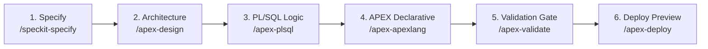

# Oracle APEX Agent Harness

A developer harness for building, validating, and deploying Oracle APEX applications with AI coding agents. Works seamlessly across **OpenCode**, **Antigravity**, **Claude Code**, **Codex**, and **DSH** without requiring paid API keys.

---

## ⚡ Quick Start

### 1. Clone & Open the Repository Root
In PowerShell, make sure your working directory is the repository root:
```powershell
# Clone the repository (if not already cloned)
git clone https://github.com/<your-org>/Oracle_Apex-Harness.git

# Navigate into the project root folder
cd Oracle_Apex-Harness
```

> [!IMPORTANT]
> **Always run commands from the repository root.**
> If you opened PowerShell using "Run as Administrator", your terminal starts in `C:\Windows\System32`. You must `cd` into your cloned repository directory before running `.\scripts\...`, otherwise PowerShell will report `The term '.\scripts\set-env.ps1' is not recognized`.

### 2. Initialize the Environment & Verify Setup
In your PowerShell session:
```powershell
# Set execution policy for the current session
Set-ExecutionPolicy -Scope Process -ExecutionPolicy Bypass

# Load environment & run health check
. .\scripts\set-env.ps1
.\scripts\harness-doctor.ps1
```
*(Tip: On Windows, you can also simply run or double-click `.\doctor.cmd` from the repo root to execute the health check directly).*

When successful, the doctor checks all tools and files, ending with `Harness is ready.`

### 3. Launch Your AI Assistant
Start your preferred agent:
```powershell
# OpenCode:
opencode

# Or Antigravity CLI:
agy

# Or Claude Code:
claude
```
*(Or open this repository directly in the Antigravity IDE, VS Code, or Codex).*

### 4. Build & Validate
Use the built-in commands and skills inside your agent chat:

| Step | OpenCode Command | Antigravity (`agy`) Skill | Description |
| :--- | :--- | :--- | :--- |
| **1. Specify** | `/speckit.specify <feature>` | `/speckit-specify <feature>` | Define requirements and user stories |
| **2. Design** | `/apex.design <feature>` | `/apex-design <feature>` | Draft domain model, business rules, & page map |
| **3. PL/SQL** | `/apex.plsql <package>` | `/apex-plsql <package>` | Package APIs & transaction boundaries |
| **4. APEXLang** | `/apex.apexlang applications/<app>` | `/apex-apexlang applications/<app>` | Generate clean `.apx` APEXLang declarative code |
| **5. Validate** | `/apex.validate applications/<app>` | `/apex-validate applications/<app>` | Deterministic APEX compile & validation gate |

*(Note: In Antigravity `agy`, skills use hyphens (`-`) like `/speckit-specify`, or you can simply ask in natural language like `"Specify a new customer portal feature"`).*

---

## 🔄 End-to-End Pipeline Walkthrough: Idea ➔ APEX App

This harness uses a **Four-Domain Engineering Pipeline** that transforms natural language business requirements into validated, production-grade Oracle APEX applications without skipping architecture, data integrity, or security checks.



### 📋 Example: "Expense Reimbursement & Approval"

Here is how a real feature travels through the harness:

#### Step 1: Specify Business Rules (`/speckit-specify` or `/speckit.specify`)
Prompt your assistant inside chat:
> `/speckit-specify Build an expense approval workflow where employees submit expense claims, managers review them, and claims over $1,000 require director approval. Rejections require a mandatory reason.`

**What the agent produces:**
Spec Kit creates a formal feature specification with traceable business rule IDs:
- `BR-EXP-001`: Expense claims $\le \$1,000$ require manager approval; claims $> \$1,000$ route to Director level.
- `BR-EXP-002`: Rejection requires a mandatory, non-empty justification comment.
- `BR-EXP-003`: Only claims in `DRAFT` or `SUBMITTED` status can be modified or withdrawn.

---

#### Step 2: Architecture & Domain Modeling (`/apex-design` or `/apex.design`)
The agent maps business rules into an architecture blueprint:
- **Data Model:**
  - Table `EXPENSES (id, employee_id, amount, description, status, approved_by, reject_reason, created_at)`
  - Check constraints for lifecycle statuses (`DRAFT`, `SUBMITTED`, `APPROVED`, `REJECTED`).
- **PL/SQL API Contract:**
  - Package `pkg_expense_mgmt` with procedures `submit_claim()`, `approve_claim()`, and `reject_claim()`.
- **APEX Page Map:**
  - **Page 1 (Dashboard):** Summary Cards with pending count badges & expense charts.
  - **Page 10 (My Expenses):** Interactive Grid with a modal entry form.
  - **Page 20 (Approval Queue):** Cards region with "Approve" / "Reject" action dialogs protected by the `MUST_BE_MANAGER` authorization scheme.

---

#### Step 3: PL/SQL Implementation (`/apex-plsql` or `/apex.plsql`)
Business logic is implemented inside database packages (following the SmartDB contract):
```sql
create or replace package pkg_expense_mgmt as
  procedure submit_claim(p_claim_id in number);
  procedure approve_claim(p_claim_id in number, p_approver_id in number);
  procedure reject_claim(p_claim_id in number, p_approver_id in number, p_reason in varchar2);
end pkg_expense_mgmt;
/
```
> [!NOTE]
> Keeping business rules inside PL/SQL ensures data integrity, makes logic unit-testable via utPLSQL, and prevents complex SQL from leaking into APEX page processes.

---

#### Step 4: Generate Declarative APEXLang (`/apex-apexlang` or `/apex.apexlang`)
The agent creates declarative `.apx` files under `applications/expense_app/`:
```text
applications/expense_app/
├── .apex/
│   └── apexlang.json                 # Version-locked to APEX 26.1 or 26.2
├── application.apx                   # App definition, theme & navigation
├── pages/
│   ├── page-1.apx                    # Dashboard Cards & Reports
│   ├── page-10.apx                   # My Expenses Interactive Grid & Modal Form
│   └── page-20.apx                   # Approval Queue (with authorization rules)
└── shared-components/
    └── authorization-schemes.apx     # MUST_BE_MANAGER scheme definition
```

---

#### Step 5: Deterministic Validation Gate (`/apex-validate` or `/apex.validate`)
Before any database import, the app tree is validated offline against the SQLcl APEX compiler:
```powershell
powershell -ExecutionPolicy Bypass -File scripts/validate-apex-app.ps1 -AppDirectory applications/expense_app
```
**Output:**
```text
Validating application in applications/expense_app...
Validation successful
0 errors, 0 warnings.
```
> [!IMPORTANT]
> The validation gate fails if there are compile diagnostics, UTF-8 BOM characters, CRLF line endings, or `ORA-` errors.

---

#### Step 6: Safe Deployment Preview & Import (`/apex-deploy` or `/apex.deploy`)
Deployments are strictly gated and previewed first using `-WhatIf`:
```powershell
# 1. Preview the import plan safely
powershell -ExecutionPolicy Bypass -File scripts/deploy-apex-app.ps1 -AppDirectory applications/expense_app -WhatIf

# 2. Deploy to target APEX instance once approved
powershell -ExecutionPolicy Bypass -File scripts/deploy-apex-app.ps1 -AppDirectory applications/expense_app
```

---

## 🐳 Disposable Local Database (DB + APEX + ORDS)

To test and develop locally without touching production or shared databases, you can spin up a disposable local database.

### ❓ Slim vs. Latest: What is the difference?

| Image Flavor | Size | Contains XML DB? | Can it run APEX? | Best For |
| :--- | :--- | :--- | :--- | :--- |
| **`slim`** (`gvenzl/oracle-free:23-slim`) | ~800 MB | ❌ No | ❌ **No** | Lightweight SQL & PL/SQL smoke tests only. |
| **`latest` / Standard** (`database/free:latest`) | ~1.1 GB | ✅ Yes | ✅ **Yes** | Smallest base DB that supports APEX. Requires ORDS & APEX installation. |
| **`adb-free:latest`** (Autonomous DB Free) | ~3 GB | ✅ Yes | ✅ **Yes (Preinstalled)** | **Smallest all-in-one image** with DB + APEX + ORDS ready out-of-the-box. |

> [!IMPORTANT]
> **Never use `slim` or `latest-lite` for APEX development.** APEX requires Oracle XML DB (`XDB`) and Oracle Text. The APEX installer halts immediately on `slim` images due to missing prerequisites.

---

### 🚀 Running the Smallest All-in-One Database (APEX + ORDS)

A pre-configured `docker-compose.yml` is ready in `local-dev/`:

```powershell
cd local-dev
docker compose up -d
```

Once started:
- **APEX URL:** [https://localhost:8443/ords/apex](https://localhost:8443/ords/apex)
- **Database Port:** `1521` (Service name: `FREEPDB1`)
- **Workspace:** `INTERNAL`
- **Admin User:** `ADMIN`
- **Default Password:** `Welcome123456#` (set via `ORACLE_PASSWORD` in your `.env`)

When you are done, dispose of the database with:
```powershell
docker compose down -v
```

*(Alternatively, run `powershell -File scripts/install-local-apex.ps1 -Execute` if you prefer the dedicated APEX 26.2 multi-container sandbox powered by `uc-local-apex-dev`).*

---

## 🛠️ Core Commands Reference

### 📋 Feature Specification (GitHub Spec Kit)
| Command | Purpose |
| :--- | :--- |
| `/speckit.specify <idea>` | Write a business specification (what & why, no tech lock-in) |
| `/speckit.clarify` | Identify and resolve requirement gaps |
| `/speckit.plan` | Generate domain model, data schema, PL/SQL API, and page architecture |
| `/speckit.tasks` | Break down the plan into ordered, testable steps |
| `/speckit.implement` | Execute tasks and build application files |

### 🎯 APEX & PL/SQL Domain Commands
| Command | Purpose |
| :--- | :--- |
| `/apex.design <feature>` | Analyze domain rules, entity relationships, and page navigation |
| `/apex.plsql <package>` | Write robust PL/SQL packages encapsulating business logic |
| `/apex.apexlang <app-dir>` | Generate clean `.apx` APEXLang declarative definitions |

### 🔒 Quality & Deployment Gates
| Command | Purpose |
| :--- | :--- |
| `/apex.verify <app-dir>` | Static verification of changed files against rules |
| `/apex.validate <app-dir>` | Run SQLcl APEX compiler validation (must report `Validation successful`) |
| `/apex.review <app-dir>` | Trigger subagent review for APEXLang, security, SQL, and accessibility |
| `/apex.deploy <app-dir>` | Import into target DB (`-WhatIf` preview first; requires approval) |

---

## 🤖 Supported Coding Assistants (No-API-Key Paths)

This repository works with multiple host assistants without paid API keys:

| Assistant | Entry File | Free / No-Key Mode |
| :--- | :--- | :--- |
| **OpenCode** | `opencode.jsonc` | Free models pinned in configuration |
| **Antigravity** | `AGENTS.md` + `.agents/` | Google account free tier |
| **Claude Code** | `CLAUDE.md` + `.claude/` | Direct `/login` with existing subscription |
| **Codex CLI** | `AGENTS.md` | Local Ollama models (`--oss --local-provider ollama`) |
| **DSH** | `AGENTS.md` + `.agents/skills` | Local Ollama models |

---

## 🛡️ Safety & Engineering Rules

1. **Evidence over claims:** Never assume an APEX build passed; verify the output of `validate-apex-app.ps1`.
2. **Deterministic file format:** `.apx` files must use **UTF-8 (no BOM)** and **LF line endings** (CRLF causes SQLcl parser errors). Run `scripts/normalize-apx-tree.ps1` to auto-fix.
3. **Read-only by default:** Database connections are strictly read-only for metadata inspection until you explicitly approve DML/DDL or deployment.
4. **No secrets in files:** Never commit `.env`, passwords, or wallet credentials. Saved SQLcl connections (`conn -save <name> -savepwd`) are used for deployment.
5. **Separation of concerns:** Business logic belongs in PL/SQL packages; APEX page processes should only orchestrate package calls.

---

## 📂 Repository Layout

```text
Oracle_Apex-Harness/
├── applications/             # Generated APEXLang applications (.apx files)
├── local-dev/                # Disposable database (docker-compose.yml & audit scripts)
├── scripts/                  # Automation scripts (doctor, validate, deploy, normalize)
├── skills/                   # Vendored Oracle APEX, APEXLang, DB, & ECC meta-skills
├── tools/                    # Local toolchain (SQLcl 26.3, OpenCode v2)
├── AGENTS.md                 # Master agent operating rules and skill routing
├── CLAUDE.md                 # Claude Code adapter
├── opencode.jsonc            # OpenCode agent & permission configuration
└── README.md                 # This guide
```

---

## 🧪 Self-Tests & Doctor

Run harness diagnostics anytime:
```powershell
# Verify all CLI tools, skills, and configuration files
powershell -ExecutionPolicy Bypass -File scripts/harness-doctor.ps1

# Run offline gate self-tests (no database required)
powershell -ExecutionPolicy Bypass -File scripts/test-harness.ps1
```
