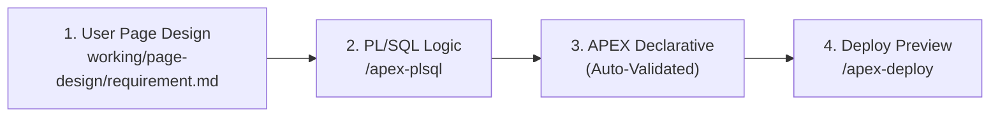

# AP3X-1 — Oracle APEX Agent Harness

A developer harness for building, validating, and deploying Oracle APEX applications with AI coding agents. Works seamlessly across **OpenCode**, **Antigravity**, **Claude Code**, **Codex**, and **DSH** without requiring paid API keys.

---

## ⚡ Quick Start (non-technical)

You do **not** need to install Java, SQLcl, Node.js, Python, or OpenCode one by one. The bootstrap installs the free prerequisites, verifies them, and prints a clear result. It never asks for an API key.

### 1. Get the folder
Download the repository as a ZIP and unzip it, or clone it with Git if you already have Git. Then open a terminal **in the repository root** (the folder that contains `README.md` and `bootstrap.cmd`).

> **Windows tip:** some bundled APEX example files have long paths. Keep the folder near the drive root (for example `C:\dev\AP3X-1`), or run `git config --global core.longpaths true` before cloning, to avoid `Filename too long` errors.

### 2. Run the one-command setup

**Windows** — double-click `bootstrap.cmd`, or run it from PowerShell:
```powershell
.\bootstrap.cmd
```

**macOS / Linux** — open Terminal, `cd` into the repository root, then run:
```bash
bash scripts/bootstrap.sh
```

The script asks for confirmation before installing anything. Add `--yes` (`-Yes` on Windows) to skip prompts. Add `--with-docker` (`-WithDocker` on Windows) only if you want the optional local Oracle Database sandbox. On macOS/Linux the script may ask for your password because system packages and Homebrew require it.

It installs only free developer tools: Git, Node.js LTS, Python 3, uv, JDK 21, SQLcl, PowerShell 7 (macOS/Linux), and OpenCode. Docker is optional. When it finishes successfully it prints `Harness is ready.` Full details and troubleshooting: [`docs/getting-started.md`](docs/getting-started.md).

### 3. Launch Your AI Assistant
Start your preferred agent:
```powershell
# OpenCode:
opencode

# Or Antigravity CLI:
agy

# Or Claude Code:
claude
```
*(Or open this repository directly in the Antigravity IDE, VS Code, or Codex).*

### 4. Build & Validate
Use the built-in commands and skills inside your agent chat:

| Step | OpenCode Command | Claude Code / Codex / Antigravity / DSH Skill | Description |
| :--- | :--- | :--- | :--- |
| **1. Requirement** | `working/page-design/requirement.md` | `working/page-design/requirement.md` | You write: pages, rules, and the look you want |
| **1b. Application Design** | `/apex.design` | `/apex-design` | Agent writes `application-design.md`; you approve before any code |
| **2. PL/SQL** | `/apex.plsql <package>` | `/apex-plsql <package>` | Package APIs & transaction boundaries |
| **3. APEXLang** | `/apex.apexlang working/app` | `/apex-apexlang working/app` | Generate clean `.apx` APEXLang declarative code |
| **4. Validate** | *(Automatic on edit)* | *(Automatic on edit)* | Deterministic SQLcl compiler validation gate |
| **5. Delivery gate** | `scripts/verify-delivery.ps1 -ProjectDirectory working` | same | Blocks delivery if anything in your requirement or design was dropped |
| **6. Runtime gate** | `node scripts/verify-apex-runtime.mjs ...` | same | After import: logs in as each role and checks the live app (errors, icons, mobile, accessibility, access control) |

*(Note: Validation runs automatically whenever APEXLang code is generated or modified).*

<details>
<summary><strong>Manual setup (advanced users)</strong></summary>

If you prefer to install tools yourself, install Git, Node.js 20+, Python 3, uv, JDK 21, and PowerShell 7, then place SQLcl under `tools/sqlcl` (the launcher is `bin/sql` on macOS/Linux and `bin/sql.exe` on Windows).

**Windows:**
```powershell
Set-ExecutionPolicy -Scope Process -ExecutionPolicy Bypass
.\bootstrap.cmd -DryRun     # preview what the bootstrap would install
. .\scripts\set-env.ps1
.\scripts\harness-doctor.ps1
```

**macOS / Linux:**
```bash
bash scripts/bootstrap.sh --dry-run
pwsh -NoProfile -File scripts/harness-doctor.ps1
```

Always run commands from the repository root. The doctor ends with `Harness is ready.` when every required tool and file is present.

</details>

---

## ✅ What the Harness Guarantees

Every rule that matters is enforced by a script, and every script has self-tests proving it catches the defect. The full list of guarantees, the gate behind each one, and the known limits are in [`docs/harness-standard.md`](docs/harness-standard.md).

- **Your requirement wins.** You write `working/page-design/requirement.md`; the agent writes `application-design.md` and waits for your approval before building.
- **Your look, not a stock theme.** Brand colours, badges, shadows and tone are implemented through the brand layer and checked mechanically.
- **Nothing silently dropped.** Every requirement line is traced to `file:line` or marked `NOT DONE` with a reason.
- **Checked live.** After import, the runtime gate logs in as each role and verifies the running app.

## 🔄 End-to-End Pipeline Walkthrough: Idea ➔ APEX App

This harness uses a **streamlined vibe coding workflow** that transforms natural language business requirements directly into validated, production-grade Oracle APEX applications without unnecessary ceremony:



### 📋 How It Works

Here is how a feature travels through the harness:

#### Step 1: User Defines Page Design & Rules (`working/page-design/requirement.md`)
You define your desired page layout, regions, items, and rules in `working/page-design/requirement.md`:
- **Pages & Components:** Page numbers, titles, reports, forms, and modal dialogs.
- **Business Rules:** Input validation, state transitions, and authorization rules.
- **Look & Feel (optional):** Brand colours, tone, shadows, badge style, icons. You are not limited to the stock Universal Theme look.

The agent then writes `working/page-design/application-design.md`: the data model, how each rule is enforced in PL/SQL, the visual design, the page/component map, and a **requirement trace** with one row per line of your requirement. It stops for your approval before writing any code, and after building it marks every row `DONE` (with file:line) or `NOT DONE: <reason>`. The agent never edits your `requirement.md`.

The assistant strictly follows your architecture rather than inventing an arbitrary design.

---

#### Step 2: PL/SQL Implementation (`/apex-plsql` or `/apex.plsql`)
Business logic is implemented inside database packages under `working/database/packages/` (following the SmartDB contract):
- Encapsulates multi-table writes, row locking, and status transitions.
- Keeps APEX page processes thin, declarative, and unit-testable via utPLSQL.
- Prevents raw SQL queries and complex business rules from scattering across pages.

---

#### Step 3: Generate Declarative APEXLang (Autonomous Auto-Validation)
The assistant creates declarative `.apx` files under `working/app/`. 

Every time an `.apx` file is generated or modified, the harness **automatically normalizes line endings and runs SQLcl `apex validate`** in the background—guaranteeing clean syntax without any manual validation commands:
```text
Validating APEX application: ...\working\app
SQLcl: ...\tools\sqlcl\bin\sql.exe
Validation successful.
APEX validation PASSED.
```
> [!IMPORTANT]
> The validation gate fails if there are compile diagnostics, UTF-8 BOM characters, CRLF line endings, or `ORA-` errors.

---

#### Step 4: Safe Deployment Preview & Import (`/apex-deploy` or `/apex.deploy`)
Deployments are strictly gated and previewed first using `-WhatIf`:
```powershell
# 1. Preview the import plan safely
powershell -ExecutionPolicy Bypass -File scripts/deploy-apex-app.ps1 -AppDirectory working/app -WhatIf

# 2. Deploy to target APEX instance once approved
powershell -ExecutionPolicy Bypass -File scripts/deploy-apex-app.ps1 -AppDirectory working/app
```

---

## 🆕 Starting a New Project (Keep vs. Reset)

Each harness workspace is dedicated to **one project at a time** inside the `working/` folder. When you are ready to build a second application, **you do not need to delete the repo or re-download tools**.

Choose the path that fits your workflow:

### Option A: Keep Project with Git Branches (Single Repo, Multiple Apps)
If you want to keep your completed project (e.g., Time-Off Portal) safely tracked while keeping your existing tools and environment ready:

1. **Commit your current project:**
   ```powershell
   git add .
   git commit -m "Complete Time-Off Portal project"
   ```
2. **Create and switch to a new branch:**
   ```powershell
   git checkout -b project/customer-portal
   ```
3. **Reset the working directory:**
   ```powershell
   powershell -NoProfile -ExecutionPolicy Bypass -File scripts/reset-project.ps1
   ```
4. Define your new page map in `working/page-design/requirement.md` and start vibe coding!
> [!TIP]
> You can switch back to your previous project anytime with `git checkout main`.

---

### Option B: Keep Project as a Separate Folder (Side-by-Side Repos)
If you prefer having separate folders on your drive (e.g., `AP3X-Project-One` and `AP3X-Project-Two`):

1. **Rename or copy your current folder:**
   ```powershell
   Rename-Item -Path "AP3X-1" -NewName "AP3X-Project-One"
   ```
2. **Clone a fresh copy of the harness template:**
   ```powershell
   git clone https://github.com/jaxontan/AP3X-1.git AP3X-Project-Two
   ```
3. **Skip tool downloads (Fast-track):** Copy the `tools/sqlcl` folder from your existing repo into the new clone so you don't need to re-download 100+ MB of tools.

---

### Option C: Reset and Archive (Disposable Workspace)
If you want to quickly start fresh in this folder without switching branches:

Run the automated reset script:
```powershell
powershell -NoProfile -ExecutionPolicy Bypass -File scripts/reset-project.ps1 -Archive
```
*(Or simply prompt your AI agent: **"Reset the working directory for a new project"**)*

- **What happens:**
  - Automatically archives your existing app deliverables into `archive/project-<timestamp>/` (when `-Archive` is passed).
  - Cleans `working/app/`, `working/database/`, and `working/page-design/credentials.md`.
  - Resets `working/page-design/requirement.md` from `docs/templates/requirement.template.md`, removes the agent's `application-design.md`, and removes any stray `requirements.md`.
  - Keeps SQLcl, JDK, rules, and test gates 100% intact and ready for instant generation.

---

## 🐳 Disposable Local Database (DB + ORDS + APEX 26.2)

To develop and test locally without touching production or shared databases, spin up Oracle AI Database 26ai Free, ORDS 26.3, and **APEX 26.2**. The ORDS container installs APEX 26.2 from the downloaded distribution on first start, so the APEX version is pinned by the zip, not by an image tag.

> The old all-in-one `adb-free:latest` compose file is gone: that tag is the **19c** image, and the 26ai `adb-free` image ships APEX 26.1.5, so neither can give you 26.2.

### 🚀 Setup & Launch

From the repository root:

```powershell
# 1. Start the database and ORDS containers (downloads APEX 26.2 on first run)
cd local-dev
docker compose up -d

# 2. Watch the one-time APEX install (10-20 minutes on first run)
docker compose logs -f ords
```

Once started:
- **APEX instance administration:** [http://localhost:8181/ords/apex_admin](http://localhost:8181/ords/apex_admin)
- **APEX workspace login:** [http://localhost:8181/ords/apex](http://localhost:8181/ords/apex)
- **Database Port:** `1521` (Service name: `FREEPDB1`)
- **Admin User:** `ADMIN` (workspace `INTERNAL`), password `Oracle123!`
- **Password for everything (ADMIN, SYS, SYSTEM, ORDS, APEX):** `Oracle123!` (or configure `ORACLE_PASSWORD` in `local-dev/.env`)
- **All logins:** [`access.md`](access.md)

After signing in to `apex_admin` as `ADMIN`, create a workspace for your app, then sign in at `/ords/apex`.

When you are finished, dispose of the database with:
```powershell
docker compose down -v
```

Full beginner walkthrough, ports, reset steps, and troubleshooting: [`local-dev/README.md`](local-dev/README.md).

*(Alternatively, run `powershell -File scripts/install-local-apex.ps1 -Execute` if you prefer the dedicated APEX 26.2 multi-container sandbox powered by `uc-local-apex-dev`).*

---

## 🛠️ Core Commands Reference

### 🎯 APEX & PL/SQL Domain Commands
OpenCode uses `/apex.<name>`; Claude Code, Codex, Antigravity, and DSH use the same workflow as `/apex-<name>` (for example `/apex.plsql` = `/apex-plsql`). The skill copies are generated from `.opencode/commands/` by `node scripts/sync-agent-commands.mjs`.

| Command | Purpose |
| :--- | :--- |
| `/apex.design <scope>` | Design page map, layout, theme, templates, and staticIds before implementation |
| `/apex.prototype <page>` | Build a standalone Universal Theme visual prototype and translation plan |
| `/apex.ui-redesign <page>` | Audit and redesign an existing page, including a custom non-default look |
| `/apex.verify-design <preview-dir>` | Render a local prototype with Playwright and run axe accessibility checks |
| `/apex.plsql <package>` | Write robust PL/SQL packages encapsulating business logic |
| `/apex.apexlang <app-dir>` | Generate clean `.apx` APEXLang declarative definitions |

### 🔒 Quality & Deployment Gates
| Command | Purpose |
| :--- | :--- |
| `/apex.verify <app-dir>` | Static verification of changed files against rules |
| *(Auto-Validation)* | Automatically executes on every `.apx` save/generation |
| `/apex.review <app-dir>` | Trigger subagent review for APEXLang, security, SQL, and accessibility |
| `/apex.deploy <app-dir>` | Import into target DB (`-WhatIf` preview first; requires approval) |
| `scripts/reset-project.ps1` | Clean or archive `working/` directory to start a new project |

### Visual Design Verification (optional)

The designer agent cannot run a browser. A separate verifier renders `working/design-preview/<name>/before.html` and `after.html` at 1440x900 and 390x844, captures screenshots, checks horizontal overflow, and runs axe WCAG 2.2 AA checks.

```bash
npm install
npx playwright install chromium
node scripts/verify-design-preview.mjs --preview working/design-preview/<name>
```

The verifier requires Node.js 22.12 or newer. On Windows PowerShell, use `npm.cmd` and `npx.cmd` if script execution is restricted. The first browser download is about 300 MB. Reports and screenshots are written to `working/design-preview/<name>/verification/`. A baseline that fails does not fail the gate when a passing `after.html` is present; `--strict` adds moderate and minor axe findings.

Design scoring remains in `skills/apex-ui-redesign/references/design-scorecard.md`. The verifier does not prove keyboard behavior, 200% zoom, states, or real APEX runtime rendering.

---

## 🤖 Supported Coding Assistants (No-API-Key Paths)

This repository works with multiple host assistants without paid API keys:

| Assistant | Entry File | Free / No-Key Mode |
| :--- | :--- | :--- |
| **OpenCode** | `opencode.jsonc` | Free models pinned in configuration |
| **Antigravity** | `AGENTS.md` + `.agents/` | Google account free tier |
| **Claude Code** | `CLAUDE.md` + `.claude/` | Direct `/login` with existing subscription |
| **Codex CLI** | `AGENTS.md` | Local Ollama models (`--oss --local-provider ollama`) |
| **DSH** | `AGENTS.md` + `.agents/skills` | Local Ollama models |

---

## 🛡️ Safety & Engineering Rules

1. **Evidence over claims:** Never assume an APEX build passed; verify the output of `validate-apex-app.ps1`.
2. **Deterministic file format:** `.apx` files must use **UTF-8 (no BOM)** and **LF line endings** (CRLF causes SQLcl parser errors). Run `scripts/normalize-apx-tree.ps1` to auto-fix.
3. **Read-only by default:** Database connections are strictly read-only for metadata inspection until you explicitly approve DML/DDL or deployment.
4. **No secrets in files:** Never commit `.env`, passwords, or wallet credentials. Saved SQLcl connections (`conn -save <name> -savepwd`) are used for deployment.
5. **Separation of concerns:** Business logic belongs in PL/SQL packages; APEX page processes should only orchestrate package calls.

---

## 📂 Repository Layout

```text
AP3X-1/
├── working/                  # Project deliverables (page-design/, database/, app/)
│   ├── page-design/          # requirement.md (you), application-design.md (agent), credentials.md
│   ├── database/             # Schemas, PL/SQL packages, and utPLSQL tests
│   └── app/                  # Declarative APEXLang application tree (.apx)
├── local-dev/                # Disposable database (docker-compose.yml & audit scripts)
├── scripts/                  # Bootstrap, doctor, validate, deploy, normalize, reset, watch
├── skills/                   # Vendored Oracle APEX, APEXLang, DB, & ECC meta-skills
├── tools/                    # Local toolchain (SQLcl 26.3, OpenCode v2)
├── docs/                     # Getting started, harness matrix, provenance, ADRs
├── AGENTS.md                 # Master agent operating rules and skill routing
├── CLAUDE.md                 # Claude Code adapter
├── bootstrap.cmd             # One-command Windows setup
├── opencode.jsonc            # OpenCode agent & permission configuration
└── README.md                 # This guide
```

---

## 🧪 Self-Tests & Doctor

Run harness diagnostics anytime.

**Windows**
```powershell
# Verify all CLI tools, skills, and configuration files
powershell -NoProfile -ExecutionPolicy Bypass -File scripts/harness-doctor.ps1

# Run offline gate self-tests (no database required)
powershell -NoProfile -ExecutionPolicy Bypass -File scripts/test-harness.ps1
```

**macOS / Linux**
```bash
pwsh -NoProfile -File scripts/harness-doctor.ps1
pwsh -NoProfile -File scripts/test-harness.ps1
```
