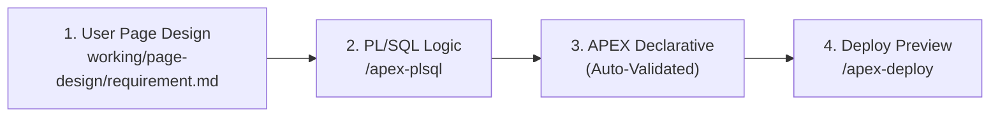

# Oracle APEX Agent Harness

A developer harness for building, validating, and deploying Oracle APEX applications with AI coding agents. Works seamlessly across **OpenCode**, **Antigravity**, **Claude Code**, **Codex**, and **DSH** without requiring paid API keys.

---

## ⚡ Quick Start

### 1. Clone & Open the Repository Root
In PowerShell, make sure your working directory is the repository root:
```powershell
# Clone the repository (if not already cloned)
git clone https://github.com/jaxontan/Oracle_Apex-Harness.git

# Navigate into the project root folder
cd Oracle_Apex-Harness
```

> [!IMPORTANT]
> **Always run commands from the repository root.**
> If you opened PowerShell using "Run as Administrator", your terminal starts in `C:\Windows\System32`. You must `cd` into your cloned repository directory before running `.\scripts\...`, otherwise PowerShell will report `The term '.\scripts\set-env.ps1' is not recognized`.

### 2. Initialize the Environment & Verify Setup
In your PowerShell session:
```powershell
# Set execution policy for the current session
Set-ExecutionPolicy -Scope Process -ExecutionPolicy Bypass

# Load environment & run health check
. .\scripts\set-env.ps1
.\scripts\harness-doctor.ps1
```
*(Tip: On Windows, you can also simply run or double-click `.\doctor.cmd` from the repo root to execute the health check directly).*

When successful, the doctor checks all tools and files, ending with `Harness is ready.`

### 3. Launch Your AI Assistant
Start your preferred agent:
```powershell
# OpenCode:
opencode

# Or Antigravity CLI:
agy

# Or Claude Code:
claude
```
*(Or open this repository directly in the Antigravity IDE, VS Code, or Codex).*

### 4. Build & Validate
Use the built-in commands and skills inside your agent chat:

| Step | OpenCode Command | Antigravity (`agy`) Skill | Description |
| :--- | :--- | :--- | :--- |
| **1. Page Design** | `working/page-design/requirement.md` | `working/page-design/requirement.md` | User-defined page map, regions & rules |
| **2. PL/SQL** | `/apex.plsql <package>` | `/apex-plsql <package>` | Package APIs & transaction boundaries |
| **3. APEXLang** | `/apex.apexlang working/app` | `/apex-apexlang working/app` | Generate clean `.apx` APEXLang declarative code |
| **4. Validate** | *(Automatic on edit)* | *(Automatic on edit)* | Deterministic SQLcl compiler validation gate |

*(Note: Validation runs automatically whenever APEXLang code is generated or modified).*

---

## 🔄 End-to-End Pipeline Walkthrough: Idea ➔ APEX App

This harness uses a **streamlined vibe coding workflow** that transforms natural language business requirements directly into validated, production-grade Oracle APEX applications without unnecessary ceremony:



### 📋 How It Works

Here is how a feature travels through the harness:

#### Step 1: User Defines Page Design & Rules (`working/page-design/requirement.md`)
You define your desired page layout, regions, items, and rules in `working/page-design/requirement.md`:
- **Pages & Components:** Page numbers, titles, reports, forms, and modal dialogs.
- **Business Rules:** Input validation, state transitions, and authorization rules.

The assistant strictly follows your architecture rather than inventing an arbitrary design.

---

#### Step 2: PL/SQL Implementation (`/apex-plsql` or `/apex.plsql`)
Business logic is implemented inside database packages under `working/database/packages/` (following the SmartDB contract):
- Encapsulates multi-table writes, row locking, and status transitions.
- Keeps APEX page processes thin, declarative, and unit-testable via utPLSQL.
- Prevents raw SQL queries and complex business rules from scattering across pages.

---

#### Step 3: Generate Declarative APEXLang (Autonomous Auto-Validation)
The assistant creates declarative `.apx` files under `working/app/`. 

Every time an `.apx` file is generated or modified, the harness **automatically normalizes line endings and runs SQLcl `apex validate`** in the background—guaranteeing clean syntax without any manual validation commands:
```text
Validating APEX application: ...\working\app
SQLcl: ...\tools\sqlcl\bin\sql.exe
Validation successful.
APEX validation PASSED.
```
> [!IMPORTANT]
> The validation gate fails if there are compile diagnostics, UTF-8 BOM characters, CRLF line endings, or `ORA-` errors.

---

#### Step 4: Safe Deployment Preview & Import (`/apex-deploy` or `/apex.deploy`)
Deployments are strictly gated and previewed first using `-WhatIf`:
```powershell
# 1. Preview the import plan safely
powershell -ExecutionPolicy Bypass -File scripts/deploy-apex-app.ps1 -AppDirectory working/app -WhatIf

# 2. Deploy to target APEX instance once approved
powershell -ExecutionPolicy Bypass -File scripts/deploy-apex-app.ps1 -AppDirectory working/app
```

---

## 🐳 Disposable Local Database (DB + APEX + ORDS)

To develop and test locally without touching production or shared databases, spin up the pre-configured all-in-one Autonomous Database Free container (DB + APEX + ORDS preinstalled):

### 🚀 Setup & Launch

```powershell
cd local-dev
docker compose up -d
```

Once started:
- **APEX URL:** [https://localhost:8443/ords/apex](https://localhost:8443/ords/apex)
- **Database Port:** `1521` (Service name: `FREEPDB1`)
- **Workspace:** `INTERNAL` (or create a workspace for your app)
- **Admin User:** `ADMIN`
- **Default Password:** `Welcome123456#` (or configure via `ORACLE_PASSWORD` in your `.env`)

When you are finished, dispose of the database with:
```powershell
docker compose down -v
```

*(Alternatively, run `powershell -File scripts/install-local-apex.ps1 -Execute` if you prefer the dedicated APEX 26.2 multi-container sandbox powered by `uc-local-apex-dev`).*

---

## 🛠️ Core Commands Reference

### 🎯 APEX & PL/SQL Domain Commands
| Command | Purpose |
| :--- | :--- |
| `/apex.plsql <package>` | Write robust PL/SQL packages encapsulating business logic |
| `/apex.apexlang <app-dir>` | Generate clean `.apx` APEXLang declarative definitions |

### 🔒 Quality & Deployment Gates
| Command | Purpose |
| :--- | :--- |
| `/apex.verify <app-dir>` | Static verification of changed files against rules |
| *(Auto-Validation)* | Automatically executes on every `.apx` save/generation |
| `/apex.review <app-dir>` | Trigger subagent review for APEXLang, security, SQL, and accessibility |
| `/apex.deploy <app-dir>` | Import into target DB (`-WhatIf` preview first; requires approval) |

---

## 🤖 Supported Coding Assistants (No-API-Key Paths)

This repository works with multiple host assistants without paid API keys:

| Assistant | Entry File | Free / No-Key Mode |
| :--- | :--- | :--- |
| **OpenCode** | `opencode.jsonc` | Free models pinned in configuration |
| **Antigravity** | `AGENTS.md` + `.agents/` | Google account free tier |
| **Claude Code** | `CLAUDE.md` + `.claude/` | Direct `/login` with existing subscription |
| **Codex CLI** | `AGENTS.md` | Local Ollama models (`--oss --local-provider ollama`) |
| **DSH** | `AGENTS.md` + `.agents/skills` | Local Ollama models |

---

## 🛡️ Safety & Engineering Rules

1. **Evidence over claims:** Never assume an APEX build passed; verify the output of `validate-apex-app.ps1`.
2. **Deterministic file format:** `.apx` files must use **UTF-8 (no BOM)** and **LF line endings** (CRLF causes SQLcl parser errors). Run `scripts/normalize-apx-tree.ps1` to auto-fix.
3. **Read-only by default:** Database connections are strictly read-only for metadata inspection until you explicitly approve DML/DDL or deployment.
4. **No secrets in files:** Never commit `.env`, passwords, or wallet credentials. Saved SQLcl connections (`conn -save <name> -savepwd`) are used for deployment.
5. **Separation of concerns:** Business logic belongs in PL/SQL packages; APEX page processes should only orchestrate package calls.

---

## 📂 Repository Layout

```text
Oracle_Apex-Harness/
├── working/                  # Project deliverables (page-design/, database/, app/)
│   ├── page-design/          # User-defined page architecture (requirement.md)
│   ├── database/             # Schemas, PL/SQL packages, and utPLSQL tests
│   └── app/                  # Declarative APEXLang application tree (.apx)
├── local-dev/                # Disposable database (docker-compose.yml & audit scripts)
├── scripts/                  # Automation scripts (doctor, validate, deploy, normalize, watch)
├── skills/                   # Vendored Oracle APEX, APEXLang, DB, & ECC meta-skills
├── tools/                    # Local toolchain (SQLcl 26.3, OpenCode v2)
├── AGENTS.md                 # Master agent operating rules and skill routing
├── CLAUDE.md                 # Claude Code adapter
├── opencode.jsonc            # OpenCode agent & permission configuration
└── README.md                 # This guide
```

---

## 🧪 Self-Tests & Doctor

Run harness diagnostics anytime:
```powershell
# Verify all CLI tools, skills, and configuration files
powershell -ExecutionPolicy Bypass -File scripts/harness-doctor.ps1

# Run offline gate self-tests (no database required)
powershell -ExecutionPolicy Bypass -File scripts/test-harness.ps1
```
