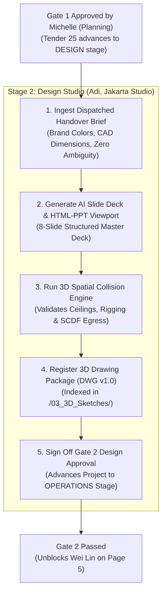

# Adi Nugroho — User Journey & Operational Specification
## Stage 2: Design Studio & 3D Spatial Feasibility
**Target Application:** Application `101` (`FLASH_PROPOSALS`)  
**Target Page:** [Page 4 – Design & Spatial Studio](file:///C:/Users/yueju/Desktop/agy/ap3x-1/working/app/pages/p00004-design-spatial.apx) (`DESIGN-SPATIAL`)  
**Persona:** **Adi Nugroho**, Senior Graphic Designer & 3D Spatial Modeler  
**Location:** Jakarta Studio (Flash Concepts Indonesia / Regional Hub)  
**Preceding Milestone:** Gate 1 Planning Sign-Off (Michelle Lee)  
**Downstream Milestone:** Gate 2 Design Sign-Off $\rightarrow$ Hand off to Wei Lin (Operations)  
**Access Credentials:** See [`working/page-design/credentials.md`](file:///C:/Users/yueju/Desktop/agy/ap3x-1/working/page-design/credentials.md)

---

## 1. Persona Profile & Context

Adi Nugroho is responsible for translating experiential strategy into visual and spatial realities for Flash Concepts' competitive B2B event tenders. 

### Core Operational Pains Solved by the Platform
1. **The "Blank Canvas" Fatigue**: Traditionally, laying out 2D pitch presentation slides took 1–2 full days of manual arrangement in PowerPoint or Illustrator.
2. **Costly 3D Rework**: Designers would build high-resolution 3D renders only to find out during venue load-in or pricing that structures exceeded ceiling limits or blocked statutory fire egress paths.
3. **Outdated Drawings in Costing**: When Adi revised CAD drawings from `v1` to `v2`, Operations would frequently continue pricing `v1` due to lack of an automated invalidation mechanism.

---

## 2. End-to-End Workflow Diagram



---

## 3. Step-by-Step User Journey

### Step 1: Ingest Dispatched Design Handover Brief (Tab 1)
* **Action**: Adi logs in and navigates to **Page 4 (Design & Spatial Studio)** with active tender `FC-2026-092` (*Nanyang Polytechnic Innovation Roadshow 2026*).
* **Interface**: **Tab 1: Dispatched Design Handover Brief** (`design-handover-report`).
* **Experience**:
  * Adi does **not** have to read an ambiguous 40-page PDF tender document.
  * The handover dispatched by Michelle from Gate 1 presents the exact aesthetic parameters:
    * **Brand Visual Identity & Palette**: Nanyang Polytechnic Crimson (`#C8102E`), Navy (`#002D62`), and Gold (`#D4AF37`).
    * **Dimensioned Specs**: 14.0m W $\times$ 8.0m D $\times$ 5.8m H proscenium stage with P2.6 curve LED wall.
    * **Demo Pod Specifications**: 3.5m $\times$ 3.5m timber pods with integrated touchscreens.

---

### Step 2: AI Slide Deck Synthesis & Interactive HTML-PPT Showcase (Tab 2 & 2b)
* **Action**: Clicks **`[Generate AI Slide Deck Drafts]`** (`GENERATE_SLIDES`).
* **System Execution**: Invokes `fc_design_api.generate_slide_deck_drafts` powered by Nemotron AI.
* **Experience**:
  * In under 3 seconds, the system synthesizes 8 complete, structured pitch slides into `fc_pitch_slides`:
    1. *Executive Vision*: Opening statement framing client objectives.
    2. *Strategic Narrative & Brief Alignment*: Experiential strategy mapped to client ethos.
    3. *Experiential Architecture & Spatial Blueprint*: Stage footprint and attendee zoning.
    4. *Curated Attendee Journey & Run-of-Show*: Step-by-step visitor progression.
    5. *Main Stage Proscenium & Technical AV Specifications*: Rigging, lighting, and LED wall.
    6. *Interactive Demo Pod Ecosystem*: Modular fringe activation layout.
    7. *Risk Mitigation & Statutory Compliance*: SCDF fire safety and BCA PE inspection notes.
    8. *Commercial Rollout Schedule & Next Steps*: Delivery milestones.
* **Interactive HTML-PPT Showcase (Tab 2b)**:
  * Adi switches to **Tab 2b: AI HTML-PPT Presentation Showcase**.
  * Previews the rendered deck inside an embedded **HTML-PPT Mini Browser Viewport** featuring macOS window controls (red/yellow/green), secure navigation bar, and responsive typography cards.
  * Adi now has a visual blueprint ready—eliminating 8+ hours of blank-canvas drafting.

---

### Step 3: Run 3D Spatial Collision & Venue Constraint Engine (Tab 3)
* **Action**: Clicks **`[Run 3D Spatial Collision Engine]`** (`RUN_SPATIAL_ENGINE`).
* **System Execution**: Invokes `fc_design_api.generate_3d_specs`, checking 5 primary structures against the verified venue profile (NYP Campus Centre Atrium):
  1. **Main Stage Proscenium & Backwall** (14.0m $\times$ 8.0m $\times$ 5.8m) vs 9.2m ceiling $\rightarrow$ **PASS** (+3.4m headroom safety buffer).
  2. **Overhead Rigged LED Ribbon Truss** (12.0m $\times$ 4.0m $\times$ 5.5m) $\rightarrow$ **PASS** (+3.7m headroom).
  3. **Acoustic Parametric Timber Pods** (4.0m $\times$ 4.0m $\times$ 3.8m) $\rightarrow$ **PASS** (+5.4m headroom).
  4. **Zero-Waste Coffee Station** (6.0m $\times$ 3.0m $\times$ 2.8m) $\rightarrow$ **PASS** (+6.4m headroom).
  5. **Campus Perimeter Fire Egress**: Layout leaves a **3.8m unobstructed corridor**, beating the mandatory **3.5m SCDF campus clearance threshold**.
* **Ad-hoc Check**: Adi can test custom structures using the **Spatial Checker** fields (`P4_STRUCT_NAME`, `P4_LEN`, `P4_WID`, `P4_HGT`).

---

### Step 4: Register 3D CAD Drawing Package & Invalidation Cascade (BR-06)
* **Action**:
  1. In **Spatial Checker & Drawing Package**, enters:
     * **Package Title** (`P4_PKG_TITLE`): `NYP_InnovSphere_Stage_and_Pods_3D.dwg`
     * **Version Number** (`P4_PKG_VER`): `1`
  2. Clicks **`[Register Drawing Package]`** (`UPLOAD_PACKAGE`).
* **System Execution**:
  * Calls `fc_design_api.upload_drawing_package`, indexing the package in `📁 /03_3D_Sketches/`.
  * **Business Rule BR-06 Enforcement**: If Adi later uploads a revision (e.g. `v2.0`), the system automatically flags all downstream Operations BOQ items as `STALE`, notifying Wei Lin that re-pricing is required.

---

### Step 5: Sign Off Gate 2 Design Approval
* **Action**:
  1. In **Gate 2 Spatial Sign-off Notes** (`P4_GATE2_COMMENTS`), enters:
     ```text
     Stage proscenium, LED curved backwall, and student demo pods verified against NYP Campus Centre 9.2m ceiling and SCDF 3.5m fire egress. Drawing package v1.0 registered into CMS. Ready for Operations costing.
     ```
  2. Clicks **`[Approve Gate 2 & Hand Off to Operations]`** (`APPROVE_GATE2`).
* **Outcome**:
  * Green alert banner updates: `GATE 2 DESIGN STATUS: SIGNED OFF & APPROVED (STAGE 3: OPERATIONS READY)`.
  * The tender stage advances from `DESIGN` to `OPERATIONS`.
  * **Wei Lin** (Operations Lead in Singapore) is automatically unblocked on **Page 5 (Operations & Costing Studio)**.

---

## 4. Before vs. After (Adi's Perspective)

| Aspect | Traditional Pitch Workflow | With Flash Proposals Platform |
| :--- | :--- | :--- |
| **Pitch Deck Drafting** | 2–3 days manually assembling slides | **Under 10 minutes** via AI Slide Deck & HTML-PPT Viewport |
| **Spatial Feasibility** | Guessed by eye; 3D renders redone when venue rejects height | **Automated 3D Collision Engine** tests height, rigging, and SCDF fire egress instantly |
| **Handoff Quality** | Scattered WhatsApp/Slack messages with vague color codes | Structured handover with HEX brand codes, CAD dimensions, and DWG registers |
| **Design Revisions** | Operations quotes outdated v1 drawings | **Automatic STALE invalidation cascade** on downstream BOQ items |

---

## 5. APEX UI Component Technical Mapping

| UI Element | APEX Internal ID / Name | Type | Action / Backing Logic |
| :--- | :--- | :--- | :--- |
| **Tender Selector** | `P4_TENDER_ID` | Select List | `@tender-lov` (Defaults to active tender context) |
| **Generate Slides** | `GENERATE_SLIDES` | Button | `fc_design_api.generate_slide_deck_drafts` |
| **Run Collision Engine** | `RUN_SPATIAL_ENGINE`| Button | `fc_design_api.generate_3d_specs` |
| **Register Drawing** | `UPLOAD_PACKAGE` | Button | `fc_design_api.upload_drawing_package` |
| **Approve Gate 2** | `APPROVE_GATE2` | Button (Hot) | `fc_design_api.approve_gate2` (Sets stage to `OPERATIONS`) |
| **Gate 2 Approved Banner**| `gate2-status-banner`| Static Content | Universal Theme `t-Alert--success` (`fc_workflow_api.is_gate_approved(..., 2)`) |
| **Gate 2 Pending Banner** | `gate2-pending-banner`| Static Content| Universal Theme `t-Alert--warning` (`not fc_workflow_api.is_gate_approved(..., 2)`) |
| **Handover Brief Tab** | `design-handover-report`| Classic Report | Queries `fc_handover_items` for `target_team = 'DESIGN'` |
| **Slide Deck Tab** | `slide-decks-report` | Classic Report | Queries `fc_pitch_slides` for generated slides |
| **HTML-PPT Viewport Tab**| `html-ppt-browser` | Dynamic Content | Calls `fc_design_api.render_html_slide_deck` |
| **Spatial Checks Tab** | `structures-report` | Classic Report | Queries `fc_spatial_checks` for collision deltas |
