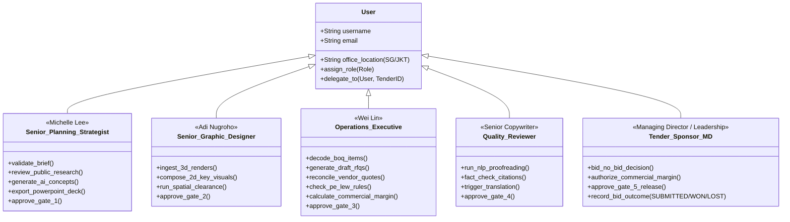
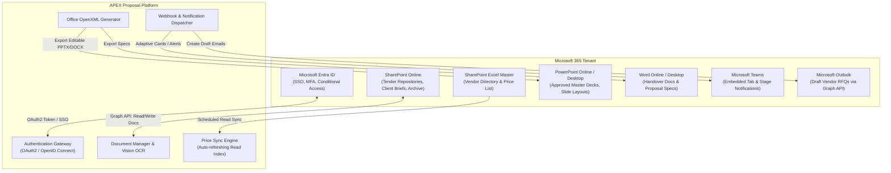
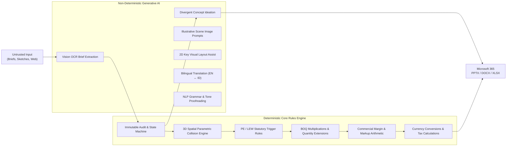

# Software Requirements Specification (SRS)
## AI-Enabled Pitch and Proposal Workflow for B2B Events
**Document Reference:** FC-SRS-2026-V2.2  
**Challenge Owner:** Flash Concepts (Singapore & Jakarta)  
**Programme:** DBS Spark GenAI Programme, in partnership with IMDA and Enterprise Singapore  
**Application ID:** `101` (`FLASH_PROPOSALS`)  
**Target Environment:** Oracle APEX 26.1 / Oracle AI Database 26ai (`FREEPDB1`) on Managed Cloud  
**Document Version:** 2.2.0 (Synchronized with Live Deployed Web Application & AI Stack)  
**Submission Deadline:** 13 November 2026, 4:00 PM SGT  
**Date:** 4 November 2026  

---

## 1. Document Control & Executive Summary

### 1.1 Purpose
This Software Requirements Specification (SRS) establishes the technical, functional, architectural, and governance requirements for the **Flash Concepts Enterprise Proposal Workflow Command System**. It translates the DBS Spark GenAI Challenge Statement (Version 2.0.0) into concrete system specifications for implementation and evaluation ahead of the 13 November 2026 submission milestone.

### 1.2 Business Context
Flash Concepts is a leading B2B experiential event management agency with approximately 25 staff across Singapore and Jakarta. Tenders are won through unpaid, highly competitive pitches requiring synchronized contributions across three core departments:
1. **Planning**: Interpreting complex client briefs, researching brand ethos, and crafting experiential concepts.
2. **Design**: Developing visual pitch themes, 3D structures, and spatial event floor plans.
3. **Operations**: Decoding technical specifications, extracting Bills of Quantities (BOQ), obtaining vendor quotations, calculating margins, and assessing statutory compliance (e.g., Professional Engineer [PE] and Licensed Electrical Worker [LEW] requirements).

### 1.3 Key Problem Statements Addressed
* **Lengthy Turnaround**: A typical pitch currently consumes ~2 weeks and ~5 staff members in a disjointed, sequential relay.
* **Fragmented Tooling**: Team coordination is distributed across ad-hoc chat, local files, and disconnected AI prompts without auditability or workflow continuity.
* **Commercial & Statutory Risks**: Manual cost estimation under tight deadlines creates margin slippage; unverified venue clearances risk costly on-site structural modifications or regulatory rejections.
* **Zero In-House IT**: The solution must be fully managed, cloud-hosted, and intuitive for non-technical event specialists without requiring dedicated IT or database administrators.

---

## 2. Business Objectives & Success Measurement Framework

The system establishes measurable targets to benchmark prototype acceptance and post-implementation performance.

### 2.1 Target Performance Metrics
| Metric | Historical Baseline | Target | Measurement Approach & Telemetry |
| :--- | :--- | :--- | :--- |
| **Overall Pitch Turnaround** | ~14 calendar days (10 working days) | **2–3 working days ($\ge 50\%$ reduction)** | Elapsed working time tracked from Gate 0 (Intake Lock) to Gate 5 (Final Release), excluding client-blocked waiting time. |
| **Total Team Effort** | ~25 man-days per pitch | **10–30% reduction in man-days** | Lightweight per-stage effort logging captured within the system by Planning, Design, and Operations. |
| **Concept Development** | 3–4 working days | **$\le 1$ working day** | System timestamp delta between Gate 0 and Gate 1 approval. |
| **Design Production** | 5–6 man-days | **Save 2–3 man-days per pitch** | Tracking hours spent on slide layout, visual composition, and CAD feasibility checks. |
| **Cost Estimate Accuracy** | $\pm 25\%$ variance against final costs | **$\ge 20\%$ accuracy improvement** | Automated comparison between Gate 3 pitch estimates and actual post-bid vendor invoices/contracts. |
| **Spatial Feasibility Accuracy** | 70–80% benchmark | **$\ge 15\%$ improvement ($\ge 90\%$)** | Spatial check logs compared against actual on-site build dimensions and venue approvals. |

### 2.2 System Measurement Telemetry
The application includes an automated background telemetry engine (`fc_telemetry_pkg`) that captures:
* Duration spent in each workflow stage (`INTAKE`, `PLANNING`, `DESIGN`, `COSTING`, `REVIEW`).
* Active working time vs. waiting time on external dependencies.
* Version lineage: Count of drawing revisions, BOQ recalculations, and translation passes.
* Estimation delta: Variance between preliminary BOQ estimates, returned vendor quotes, and final client prices.

---

## 3. Personas, Roles & Access Governance

The system replaces generic titles with real Flash Concepts operational personas, establishing clear separation of duties and automated delegation paths.

### 3.1 Persona Summary & Default Permissions
1. **Senior Planning Strategist (Michelle Lee)**:
   * *Responsibilities*: Ingests client briefs from SharePoint, oversees supervised public research, generates divergent creative concepts, exports concept slide decks, and compiles downstream handovers.
   * *Authority*: Approves **Gate 0** (Intake Lock) and **Gate 1** (Planning Approval).
2. **Senior Graphic Designer (Adi Nugroho)**:
   * *Responsibilities*: Ingests rendered 3D structure images (from team CAD/3D software), composes finished 2D pitch key visuals with realistic placeholder client graphics, evaluates preliminary spatial clearance against venue perimeters.
   * *Authority*: Approves **Gate 2** (Design Approval).
3. **Operations Executive (Wei Lin)**:
   * *Responsibilities*: Ingests dimensioned drawings/sketches, extracts BOQ items, generates draft RFQ emails for human review, reconciles vendor quotes, evaluates statutory PE/LEW compliance, verifies profit margins.
   * *Authority*: Approves **Gate 3** (Operations Approval).
4. **Copywriter & Translation Reviewer**:
   * *Responsibilities*: Conducts NLP-assisted proofreading and fact-checking across all pitch collateral; initiates and verifies bilingual translations (English $\leftrightarrow$ Bahasa Indonesia) for proposals and internal handovers.
   * *Authority*: Approves **Gate 4** (Copy & Translation Approval).
5. **Tender Sponsor / Managing Director**:
   * *Responsibilities*: Conducts initial commercial bid/no-bid decision; reviews consolidated pricing, risk profile, and profit margins; authorizes final proposal dispatch.
   * *Authority*: Approves **Gate 5** (Final Release Approval) and records subsequent bid outcome (`WON` / `LOST`).
6. **System Administrator**:
   * *Responsibilities*: Manages user role mappings, configures temporary project delegations, maintains venue and rule libraries, monitors API usage budgets.

---

## 4. End-to-End Workflow & Six-Gate Governance

The proposal lifecycle advances through six discrete, non-bypassable human gates. At any point, a gate approver can **Approve**, **Reject with Comments**, or **Request Changes**, automatically notifying upstream leads and highlighting affected downstream collateral.

```mermaid
flowchart TD
    S0["Stage 0: Bid / No-Bid Decision\n(Leadership / MD outside system)"] --> S1["Stage 1: Tender Intake & Brief Ingestion\n(Upload Briefs, Vision OCR, Knowledge Extraction)"]
    S1 --> G0{"Gate 0: Intake Confirmation\n(Planning Lead verifies scope)"}
    
    G0 -->|Confirmed| S2["Stage 2: Supervised Public Research\n(Client Web, LinkedIn, News, Google Search)"]
    S2 --> S3["Stage 3: Concept Ideation & Handover\n(3 AI Concepts, Scene Images, PPTX Export)"]
    S3 --> G1{"Gate 1: Planning Sign-Off\n(Michelle approves concept & collateral list)"}
    
    G1 -->|Approved| S4["Stage 4: 2D Key Visuals & Spatial Clearance\n(Render Composition, Venue Limits, PE Triggers)"]
    G1 -.->|Preliminary Brief| S5["Stage 5: BOQ Extraction & RFQ Preparation\n(Drawing Ingestion, Material Specs, Draft Emails)"]
    
    S4 --> G2{"Gate 2: Design Sign-Off\n(Adi approves visual package & dimensions)"}
    G2 --> S5
    
    S5 --> S6["Stage 6: Vendor Quote Reconciliation\n(Excel Rates, Quote Comparison, Margin Markup)"]
    S6 --> S7["Stage 7: Statutory Compliance Review\n(BCA, SCDF, EMA, PE/LEW Costing)"]
    S7 --> G3{"Gate 3: Operations Sign-Off\n(Wei Lin approves BOQ, RFQs & Margin)"}
    
    G3 --> S8["Stage 8: Copy Quality, Fact-Check & Translation\n(NLP Proofread, Fact Verification, EN/ID Translation)"]
    S8 --> G4{"Gate 4: Copy & Localisation Sign-Off\n(Copywriter approves final bilingual content)"}
    
    G4 --> S9["Stage 9: Final Assembly & Client Release\n(Consolidated PPTX/Word/Excel Export)"]
    S9 --> G5{"Gate 5: Final Release Sign-Off\n(MD authorizes release; status: SUBMITTED)"}
    
    G5 --> S10["Stage 10: Outcome & Archive\n(Record WON / LOST, Actuals vs Estimates)"]
    
    G0 -.->|Rework| S1
    G1 -.->|Rework| S3
    G2 -.->|Rework| S4
    G3 -.->|Rework| S5
    G4 -.->|Rework| S8
    G5 -.->|Rework| S5
```

---

## 5. Detailed Page-by-Page Requirements Specification

### Page 0: Global Page (`p00000-global-page.apx`)
* **Page Name**: Global Page
* **Alias**: `GLOBAL`
* **Purpose**: Universal Theme application master housing shared application styles (`brand.css`), global navigation bars, session timeouts, and cross-page notification banners.

---

### Page 1: Enterprise Proposal Command Center & File Explorer (`p00001-dashboard.apx`)
* **Page Name**: Pipeline Dashboard
* **Alias**: `DASHBOARD`
* **Target Personas**: All Roles (Michelle, Adi, Wei Lin, Copywriter, MD)

#### User Actions (What the User Can Do)
1. **Dynamic SharePoint-Style File Navigation**:
   * Navigate through the cloud document repository using breadcrumbs and directory tree:  
     `SharePoint > Flash Concepts > Tenders > 2026 > [Month] > [Project_Code] > [Stage_Folder]`
   * Explore departmental sub-folders: `01_Planning`, `02_Designing`, `03_Operations`.
   * Click any project folder or tree node to descend; click **Up** (`fa-arrow-up`) or **Back** (`fa-arrow-left`) to ascend.
   * Click **Refresh** (`fa-refresh`) to synchronize the live tree directly from the database and SharePoint repository.
2. **Launch Stage Workspaces**:
   * Click directly on any project card’s action button (e.g., *"Step 2: Planning Studio"*, *"Step 3: Spatial Studio"*, *"Step 4: Operations & Costing"*) to navigate to that page with the tender session state (`P#_TENDER_ID`) pre-loaded.
   * In document list view, click *"Open in Studio"* on any file to open the specific studio page managing that artifact.
3. **Pipeline Kanban Board Modal**:
   * Click **"Pipeline Kanban Board"** button on the toolbar to open an interactive modal popup tracking tender stages:
     * **Submitted / In Review**: Completed proposals awaiting client tender award.
     * **In Progress**: Active competitive bids advancing through Gates 1–4.
     * **Intake / Pipeline**: New incoming briefs in Stage 1 intake.
   * Each card displays tender code, client name, estimated budget, active stage, and direct launch buttons.
4. **Initiate New Tender Intake**:
   * Click **"+ New Tender Intake"** in the top action bar, in the explorer toolbar, or in the sidebar Quick Access menu to immediately navigate to Page 2 (`p00002-intake-review.apx`).
5. **Real-Time Search & View Modes**:
   * Type in the search input (`#fc-search-input`) to instantly filter visible folders or files.
   * Toggle between **Grid Cards View** and **Details Table View** (showing Document Name, Category, Version, Size, Author, and Action).

#### Functional Features & Technical Architecture
* **Live AJAX Backend Engine**: Page process `GET_EXPLORER_DATA` (`ajaxCallback`) calls `fc_planning_api.get_explorer_data_json`. Client-side JavaScript `fcRefreshFromDb()` invokes `apex.server.process('GET_EXPLORER_DATA')` to dynamically re-render the tree.
* **Interactive Tree View**: Populated by `fcRenderSidebarTree()` with interactive carets (`fa-caret-down`/`fa-caret-right`) for years, months, and projects, plus distinct icons for stage folders.

---

### Page 2: Tender Intake, Brief Extraction & Supervised Research (`p00002-intake-review.apx`)
* **Page Name**: Tender Setup & Intake Review
* **Alias**: `INTAKE-REVIEW`
* **Target Persona**: Senior Planning Strategist (Michelle Lee), Tender Coordinators

#### User Actions (What the User Can Do)
1. **Register Tender Workspace & Customer Selection**:
   * Select an existing tender via `P2_TENDER_ID` or create a new tender workspace.
   * **Customer Choice Logic**: Toggle `P2_CUSTOMER_CHOICE` between:
     * `EXISTING`: Disables new client name text field and populates client name from selected records.
     * `NEW_CLIENT`: Dynamically displays `P2_NEW_CLIENT_NAME` for registering a new client entity.
   * Enter project parameters: `P2_TITLE` (Project Title), `P2_CLIENT_NAME` (Client Entity), `P2_OFFICE` (`SG` / `JKT`), `P2_CURRENCY` (`SGD` / `IDR` / `USD`), `P2_BUDGET_CEILING` (Client Budget Ceiling), `P2_DEADLINE_DAYS` (Submission Deadline in days).
   * Click **"Create New Tender"** (`create-tender`) to execute `fc_planning_api.create_tender`, assigning a systematic tender code (e.g., `FC-2026-092`) and initializing SharePoint tender folders.
2. **Upload & Extract Brief (Vision-Based Multimodal OCR via Nemotron AI)**:
   * Select client tender documents via `P2_BRIEF_FILE` (supports PDF, DOCX, scanned multi-page briefs, and initial sketches).
   * Click **"Upload & Run AI Brief Extraction"** (`analyze-brief`) to execute `fc_planning_api.ingest_and_parse_brief` powered by NVIDIA Nemotron-3.5-Super-VL.
   * The pipeline parses document structure, classifies document types (`BRIEF`, `ADDENDUM`, `VENUE_SPEC`), and extracts key fields: event dates, target audience, mandatory deliverables, submission format, venue requirements, and explicit constraints.
3. **Inspect Intake Intelligence & Verification**:
   * Review tabbed findings:
     * **Uploaded Documents**: File name, type, size, version number, uploader.
     * **Diagnostic Intake Criteria**: 8 core extracted criteria with source document, exact page reference, extraction confidence score, and reviewer validation status.
     * **Early Warning Planning Flags**: Missing deliverables, tight deadlines, unconfirmed hall heights, or conflicting dates flagged without inventing data.
     * **Event Archives**: Historical Flash Concepts pitches for the same client or similar industry for precedent analysis.
4. **Gate 0 Verification Panel & Field Overrides**:
   * Under **Gate 0 Verification & Field Overrides**:
     * Select criterion to override in `P2_EDIT_FIELD_ID` (populated via `@intake-criteria-lov`).
     * Edit confirmed value in `P2_EDIT_CONFIRMED_VAL`.
     * Update review status in `P2_EDIT_REVIEW_STATUS` (`PENDING`, `CONFIRMED`, `EDITED` via `@review-status-lov`).
     * Click **"Confirm Criterion Value"** (`save-criterion-btn`) to commit verified values to `fc_intake_fields`.
5. **Operational Flag Mitigation Editor**:
   * Select operational/safety flag in `P2_EDIT_FLAG_ID` (populated via `@planning-flags-lov`).
   * Enter operational mitigations in `P2_EDIT_MITIGATION_NOTES` (e.g., aisle widening, rigging certifications).
   * Click **"Save Mitigation Notes"** (`save-mitigation-btn`) to update `fc_planning_flags`.
6. **Conduct Supervised Public Client Research**:
   * Enter query in `P2_RESEARCH_QUERY` (e.g., *"Nanyang Polytechnic brand visual identity Crimson Navy Gold"*).
   * Select source in `P2_RESEARCH_ENGINE` (NVIDIA Nemotron-3.5-VL, Client Official Website, LinkedIn Corporate Profile, Google Search / Press Releases).
   * *Confidentiality Guard*: System previews the query before dispatch. Prohibits sending confidential client budget, proprietary tender text, or unpublished strategies to external search engines.
   * Click **"Run Supervised Public Research"** (`run-ai-search`) to fetch public evidence.
   * In the Research Findings report, click **"Approve Citation"** or **"Reject Citation"**. Approved citations are stamped with source URL, retrieval timestamp, reviewer identity, and citation badge.
7. **Confirm Gate 0 (Intake Confirmation & Lock)**:
   * Review all extracted parameters, approved citations, and mitigated operational flags.
   * Click **"Confirm Gate 0 Intake & Lock Brief"** (`confirm-gate0-intake-btn`) to advance tender state to `INTAKE_CONFIRMED` / `PLANNING`.
   * Dynamic Universal Theme status alert updates immediately to **GATE 0 STATUS: CONFIRMED & LOCKED**.

#### Functional Features & Technical Architecture
* **Vision-Based OCR & Document Parsing**: Grounded extraction engine using NVIDIA Nemotron-3.5-Super-VL that preserves exact page numbers and snippet boundaries.
* **Confidential Research Proxy**: Sanitizes search queries to prevent IP leakage; logs all outbound search queries for security audits.
* **Database Entities**: `fc_tenders`, `fc_tender_documents`, `fc_intake_fields`, `fc_planning_flags`, `fc_event_archives`, `fc_research_findings`.

---

### Page 3: Planning Studio, Concept Generation & Gate 1 Handover (`p00003-planning-studio.apx`)
* **Page Name**: Planning Studio & Gate 1
* **Alias**: `PLANNING-STUDIO`
* **Target Persona**: Senior Planning Strategist (Michelle Lee)

#### User Actions (What the User Can Do)
1. **Corporate Strategic Intelligence Query**:
   * Input research query in `P3_RESEARCH_QUERY` and select provider in `P3_SEARCH_ENGINE`.
   * Click **"Run Deep Client Research"** (`run-deep-research`) to execute `fc_planning_api.run_client_research`.
   * Live client intelligence is synthesized in 2 seconds via Nemotron AI and rendered under **Client Strategic Intelligence & Citations** with confidence ratings and source URLs.
2. **Generate Differentiated AI Concepts with Scene Renders**:
   * Click **"Generate 3 AI Concepts"** (`generate-concepts`) to execute `fc_planning_api.generate_concept_options`.
   * System generates 3 creative concept options (Option A Hero, Option B High-Tech, Option C Sustainable) in `fc_concept_options`, each comprising:
     * Concept title, overarching theme, and creative narrative.
     * Fit-to-brief justification linking directly to client objectives.
     * Proposed attendee event flow and experiential journey map.
     * **Preliminary Spatial & Clearance Specs**: Stage dimensions, curve LED wall, and safety buffers.
     * **Live AI Scene Render Images**: High-resolution photorealistic scene representations generated on the fly via `Pollinations.ai` (`https://image.pollinations.ai/prompt/...`) embedded in each concept card.
3. **Declarative Hero Concept Selection**:
   * Select preferred concept from the human-readable dropdown `P3_CONCEPT_ID` (populated via `@concept-options-lov`).
   * Click **"Select Winning Concept"** (`select-concept`).
   * The selected option immediately receives a gold **★ HERO CONCEPT** badge (`t-Badge t-Badge--warning`) across all views.
4. **Compile Downstream Departmental Handover**:
   * Click **"Compile Downstream Handover"** (`generate-handover`) to execute `fc_planning_api.generate_handover`.
   * Dynamically synthesizes client-specific handover packages into `fc_handover_items`:
     * **DESIGN**:
       1. *Brand Visual Identity & Colour Palette*: Client-specific brand codes (e.g., Nanyang Polytechnic Crimson `#C8102E`, Navy `#002D62`, Gold `#D4AF37`).
       2. *14.0m Proscenium Main Stage CAD Drawing & Dimensioned Plans*: 14.0m W $\times$ 8.0m D $\times$ 5.8m H stage with P2.6 curve LED wall and 3.2m safety clearance.
       3. *8-Slide Executive Pitch Deck Master*: Coherent corporate narrative eliminating blank-canvas design work.
     * **OPERATIONS**:
       1. *Venue Load-In & 3-Phase 63A Power Tap Provisions*: Dedicated 3-phase 63A tap with Licensed Electrical Worker (LEW) turn-on certification.
       2. *Detailed BOQ Extraction & Historical Rate Benchmarking*.
       3. *Bespoke RFQ Dispatch*: Ready-to-review draft tenders for Kingsmen Exhibits and Pico Art International.
5. **Approve / Reject Gate 1 (Planning Sign-Off)**:
   * Enter review feedback in `P3_GATE1_COMMENTS`.
   * Click **"Approve Gate 1 & Dispatch Handover"** (`approve-gate1`) with modal confirmation:
     * Advances tender stage to `DESIGN`.
     * Marks handover items as `COMPLETED`.
     * Updates dynamic status banner to **GATE 1 PLANNING STATUS: SIGNED OFF & APPROVED (STAGE 2: DESIGN READY)**.
     * Unblocks Adi (Senior Designer) on Page 4.

#### Functional Features & Technical Architecture
* **Generative Multimodal Pipeline**: Seamlessly pairs Nemotron-3.5-VL narrative generation with Pollinations.ai instant visual rendering.
* **Dual-Track Handover Generation**: Automatically splits the creative concept into actionable technical task lists for Design and Operations.
* **Database Entities**: `fc_concept_options`, `fc_handover_items`, `fc_research_findings`, `fc_workflow_gates`, `fc_tenders`.

---

### Page 4: 2D Key Visual Composition & Spatial Feasibility (`p00004-design-spatial.apx`)
* **Page Name**: Spatial Design & Gate 2
* **Alias**: `DESIGN-SPATIAL`
* **Target Persona**: Senior Graphic Designer (Adi Nugroho), Senior Planning Strategist

#### User Actions (What the User Can Do)
1. **Ingest Dispatched Design Handover Brief (Tab 1)**:
   * Reviews exact aesthetic parameters handed over from Planning Gate 1 without ambiguity: brand hex colors, CAD dimensions, and required deliverables.
2. **Generate AI Slide Deck Drafts & HTML-PPT Showcase (Tab 2 & 2b)**:
   * Click **"Generate AI Slide Deck Drafts"** (`generate-slides`).
   * The AI generates 8 structured pitch slides in `fc_pitch_slides` with narrative focus and visual placeholder prompt blueprints.
   * **Interactive HTML-PPT Mini Browser Viewport (Tab 2b)**:
     * Rendered via `fc_design_api.render_html_slide_deck` (adapted from the HTML-PPT skill).
     * Displays responsive slide cards inside a mini-browser window with macOS-style controls (red/yellow/green), address bar, and Flash Concepts corporate typography.
3. **Run 3D Spatial Collision & Feasibility Engine (Tab 3)**:
   * Click **"Run 3D Spatial Collision Engine"** (`run-spatial-engine`) to execute `fc_design_api.generate_3d_specs`.
   * Evaluates 5 primary structures against venue constraints (ceiling height, floor loading, SCDF egress):
     * *Main Stage Proscenium (5.8m H)* vs 9.2m ceiling $\rightarrow$ `PASS` (+3.4m headroom).
     * *Overhead Rigged Ribbon Truss (5.5m H)* $\rightarrow$ `PASS` (+3.7m clearance).
     * *Acoustic Pods (3.8m H)* $\rightarrow$ `PASS` (+5.4m headroom).
     * *SCDF Perimeter Fire Egress* $\rightarrow$ Confirms 3.8m clear passageway, beating statutory 3.5m requirement.
   * *(Optional)* Conduct ad-hoc checks using the **Spatial Checker** fields (`P4_STRUCT_NAME`, `P4_LEN`, `P4_WID`, `P4_HGT`).
4. **Register Drawing Package & Invalidation Cascade (BR-06)**:
   * Enter `P4_PKG_TITLE` (e.g., `NYP_InnovSphere_Stage_and_Pods_3D.dwg`) and version `P4_PKG_VER`.
   * Click **"Register Drawing Package"** (`upload-package`) to freeze package in `📁 /03_3D_Sketches/`.
   * **BR-06 Rule**: If a revision (e.g., v2.0) is registered later, the system automatically marks downstream Operations BOQ items as `STALE`, mandating re-review.
5. **Approve / Reject Gate 2 (Design Approval)**:
   * Enter clearance notes in `P4_GATE2_COMMENTS`.
   * Click **"Approve Gate 2 & Hand Off to Operations"** (`approve-gate2`):
     * Advances tender stage to `OPERATIONS`.
     * Dynamic status banner updates to **GATE 2 DESIGN STATUS: SIGNED OFF & APPROVED (STAGE 3: OPERATIONS READY)**.
     * Unblocks Wei Lin (Operations Lead) on Page 5.

#### Functional Features & Technical Architecture
* **HTML-PPT Skill Viewport**: Declarative PL/SQL dynamic content rendering an embedded presentation viewer.
* **Parametric Spatial Rule Evaluator**: Deterministic checks comparing user dimensions against authoritative venue profiles in `fc_venues`.
* **Database Entities**: `fc_handover_items`, `fc_pitch_slides`, `fc_spatial_checks`, `fc_drawing_packages`, `fc_venues`, `fc_tenders`.
* **Page Name**: Spatial Design & Gate 2
* **Alias**: `DESIGN-SPATIAL`
* **Target Persona**: Senior Graphic Designer (Adi Nugroho), Senior Planning Strategist

#### User Actions (What the User Can Do)
1. **Ingest 3D Renders & Dimensional Drawings**:
   * Select tender via `P4_TENDER_ID`.
   * Upload or link rendered 3D structure images produced by the design team in their specialist 3D software (e.g., 3ds Max, Blender, SketchUp, AutoCAD).
   * Upload dimensioned layout drawings or sketches (PDF, PNG, DWG).
2. **Compose 2D Pitch Key Visuals**:
   * Click **"Generate 2D Key Visual Compositions"** (`generate-slides`).
   * The system combines the designer’s rendered 3D structural elements with graphic background themes, event typography, and lighting accents into finished 2D presentation visuals.
   * Suggests realistic placeholder client graphics (logos, campaign slogans, brand colors) extracted from Stage 2 public research, visibly labeled as *"Placeholder Content"*.
3. **Run 3D Spatial Collision & Feasibility Engine**:
   * Select target exhibition venue from `P4_VENUE_ID` (e.g., Suntec Singapore, Singapore EXPO, Marina Bay Sands, ICE BSD).
   * Enter structure dimensions: `P4_STRUCT_NAME`, `P4_LEN` (m), `P4_WID` (m), `P4_HGT` (m).
   * Click **"Run 3D Spatial Collision Engine"** (`run-spatial-engine`) to execute `fc_spatial_api.run_spatial_checks`.
   * The parametric engine checks physical clearance against venue data:
     * Ceiling and rigging clearance (alerts if height exceeds venue maximum or trigger heights).
     * Door clearance and loading dock access dimensions for freight logistics.
     * Floor loading capacity ($kN/m^2$) against structure footprint weight.
     * **Statutory PE Trigger**: Explicitly flags if structure height exceeds **4.0 meters**, mandating Professional Engineer (PE) structural calculations.
4. **Preview & Register Drawing Package**:
   * Preview slide layouts in the embedded interactive HTML presentation viewer (`#fc-ppt-frame`).
   * Enter package metadata: `P4_PKG_TITLE`, `P4_PKG_VER`.
   * Click **"Register Drawing Package"** (`upload-package`) to freeze the design package for Operations.
5. **Approve / Reject Gate 2 (Design Approval)**:
   * Enter clearance notes in `P4_GATE2_COMMENTS`.
   * Click **"Approve Gate 2 & Hand Off to Operations"** (`approve-gate2`) with modal confirmation to advance tender state to `COSTING_BOQ`.
   * Or click **"Reject Gate 2"** (`reject-gate2`) if spatial clearances fail.

#### Functional Features & Technical Architecture
* **Visual Composition Engine**: Blends 3D structure renders with 2D graphic assets without replacing specialized 3D CAD modeling software.
* **Parametric Spatial Rule Evaluator**: Deterministic checks comparing user dimensions against authoritative venue profiles in `fc_venues`.
* **Database Entities**: `fc_dimensional_structures`, `fc_slide_decks`, `fc_drawing_packages`, `fc_venues`.

---

### Page 5: Operations, BOQ Costing & Quotation Reconciliation (`p00005-operations-costing.apx`)
* **Page Name**: Operations, BOQ & Costing
* **Alias**: `OPERATIONS-COSTING`
* **Target Persona**: Operations Executive (Wei Lin), Estimators

#### User Actions (What the User Can Do)
1. **Decode BOQ & Extract Materials**:
   * Select tender via `P5_TENDER_ID`.
   * Ingest the approved Gate 2 drawing package (sketches, PDF plans, DWG files).
   * Click **"Decode BOQ & Extract Items"** (`decode-boq`) to execute `fc_costing_api.decode_boq_from_drawings`.
   * Automatically extracts components, dimensions, material types (timber, acrylic, modular aluminum, fabric), colors/finishes, and quantities.
2. **Review Material Specification Sheets**:
   * Review extracted items in the BOQ report: item code, description, quantity, unit of measure (`m`, `m2`, `pcs`, `lot`).
   * Flag potential **Reusable Assets** identified from past project inventories to minimize fabrication costs.
   * Map components to internal master price lists ingested from the SharePoint Excel price workbook.
3. **Prepare Draft Vendor RFQs (No Autonomous Sending)**:
   * Click **"Generate Draft Vendor RFQs"** (`generate-rfqs`) to execute `fc_costing_api.generate_vendor_rfqs`.
   * System suggests suitable fabrication vendors based on service capability, trade specialization (AV, carpentry, metalwork, electrical), and geographic region (Singapore vs. Jakarta).
   * Formats structured draft RFQ emails with attached technical specifications, required return dates, and response templates.
   * *Strict Restriction*: RFQs are **never** sent autonomously. The Operations Executive must review each email, edit scope if necessary, and approve sending.
4. **Reconcile Returned Vendor Quotations**:
   * Inspect returned quotes in the Quotations report: quoted price, inclusions, exclusions, lead time, and validity.
   * Compare quoted rates against baseline estimates; flag scope variances or missing items.
   * Select preferred quote via `P5_QUOTE_ID`, enter award justification in `P5_SELECT_REASON`, and click **"Award Vendor Quote"** (`proc-select-quote`).
5. **Evaluate Statutory Compliance & PE/LEW Costs**:
   * Click **"Evaluate Statutory Compliance & PE Rules"** (`evaluate-compliance`) to execute `fc_costing_api.evaluate_statutory_compliance`.
   * Evaluates booth dimensions, structural spans, and electrical distribution against Singapore (BCA, SCDF, EMA) and Jakarta regulations:
     * **BCA PE Certification**: Triggered if booth height $>4.0m$ or multi-tier mezzanine is used; adds estimated PE endorsement fee (~SGD 1,800.00).
     * **EMA LEW Licensing**: Triggered if power load $>32A$ or complex 3-phase power is required; adds estimated LEW turn-on certification fee (~SGD 850.00).
     * **SCDF Fire Safety**: Verifies aisle widths ($\ge 3.0m$) and flame-retardant material certifications.
6. **Calculate Commercial Margins & Markups (Reconciled Financial Formula)**:
   * In accordance with Flash Concepts commercial policy, profit margin is defined deterministically:
     $$\text{Margin \%} = \frac{\text{Price} - \text{Cost}}{\text{Price}} \times 100\% \quad \Longleftrightarrow \quad \text{Price} = \frac{\text{Cost}}{1 - \text{Margin \%}}$$
     $$\text{Markup \%} = \frac{\text{Price} - \text{Cost}}{\text{Cost}} \times 100\% = \frac{\text{Margin \%}}{1 - \text{Margin \%}}$$
   * To achieve the corporate target margin of $\ge 45\%$, the baseline markup applied to direct fabrication cost is **$\approx 81.8\%$** (or calibrated tiered markups: $82\%$ custom carpentry, $35\%$ pass-through AV rentals, $50\%$ standard display systems).
   * Enter calibrated markup percentage in `P5_MARKUP_PCT` and click **"Recalculate BOQ Total & Margin"** (`calc-boq`).
   * System computes total direct costs, contingency reserve ($5\%$), client price, and verified profit margin percentage, displaying clear warnings if the calculated margin falls below the $45.0\%$ corporate threshold.
7. **Approve / Reject Gate 3 (Operations Approval)**:
   * Enter review comments in `P5_GATE3_COMMENTS`.
   * Click **"Approve Gate 3 & Advance to Copy Review"** (`approve-gate3`) with modal confirmation to advance tender state to `COPY_LOCALISATION`.
   * Or click **"Reject Gate 3"** (`reject-gate3`) if vendor quotes exceed client budget ceiling.

#### Functional Features & Technical Architecture
* **Mathematical Precision**: Deterministic PL/SQL arithmetic engine guarantees rounding consistency and prevents floating-point margin drift.
* **Vendor Directory Integration**: Dynamic vendor directory supporting varied trade categories without hardcoding vendor names.
* **Database Entities**: `fc_boq_items`, `fc_rfqs`, `fc_quotations`, `fc_compliance_findings`, `fc_compliance_rules`, `fc_tenders`.

---

### Page 6: Copy Quality, Fact-Checking & Multilingual Release Hub (`p00006-final-release.apx`)
* **Page Name**: Multilingual Final Release
* **Alias**: `FINAL-RELEASE`
* **Target Personas**: Senior Copywriter, Translation Reviewer, Managing Director / Leadership

#### User Actions (What the User Can Do)
1. **NLP Proofreading & Tone Verification**:
   * Inspect consolidated proposal text assembled from Planning, Design, and Operations.
   * The NLP engine runs automated checks for:
     * Grammar, spelling, and corporate terminology consistency.
     * Tone of voice matching Flash Concepts' premium editorial standard.
     * Name, date, and numerical consistency across slide decks, specification sheets, and pricing tables.
2. **Automated Fact-Checking & Claim Verification**:
   * System scans proposal narrative against the tender brief, approved research citations, and internal records.
   * Every factual claim is verified:
     * Verified claims display green source citation badges.
     * Unverified or ambiguous statements are flagged as *"Unsupported Claim — Requires Revision"*. Prohibits publishing unverified client performance claims.
3. **Trigger Bilingual Translation (English $\leftrightarrow$ Bahasa Indonesia)**:
   * Click **"Execute Bilingual Translation"** (`proc-trigger-translation`).
   * Generates localized Bahasa Indonesia translations for pitch slide decks, executive summaries, and technical handover documents to support seamless Singapore $\leftrightarrow$ Jakarta operations.
   * Preserves formatting, metric units, currency notations (SGD / IDR), and technical event terminology.
4. **Approve Gate 4 (Copy & Localisation Approval)**:
   * Copywriter and Translation Reviewer inspect side-by-side bilingual outputs.
   * Enter review notes in `P6_GATE4_COMMENTS` and click **"Approve Gate 4 (Copy & Translation)"** (`approve-gate4`) to certify all written content.
5. **Authorize Gate 5 (Final Proposal Release Approval)**:
   * Leadership / Managing Director reviews the complete commercial proposal package:
     * Approved concept presentation deck (`.pptx`).
     * Technical specifications and drawing package (`.dwg` / `.pdf`).
     * Itemized BOQ pricing and margin sheet (`.xlsx`).
     * Statutory compliance and PE/LEW certificate notes.
   * Enter executive release authorization in `P6_GATE5_COMMENTS`.
   * Click **"Authorize Proposal Release (Gate 5)"** (`release-proposal`) with modal confirmation.
   * System marks tender state as **`SUBMITTED`** (not `CLOSED_WON`) and logs an immutable cryptographic audit record.
6. **Record Client Bid Outcome (Post-Submission Tracking)**:
   * Once the client awards the tender, an authorized user opens the tender and records the actual outcome:
     * **`CLOSED_WON`**: Locks final contract value and initiates operational execution handover.
     * **`CLOSED_LOST`**: Records loss reason (price, design, timeline) to feed the historical learning store.

#### Functional Features & Technical Architecture
* **Strict Gate Separation**: Decouples editorial proofreading (Gate 4) from commercial release authorization (Gate 5).
* **State Integrity**: System strictly blocks Gate 5 execution if any upstream gate is pending, if critical unsupported claims remain, or if documents stem from mismatched drawing versions.
* **Database Entities**: `fc_bilingual_translations`, `fc_tenders`, `fc_audit_log`.

---

### Page 7: Venue Constraints & Statutory PE/LEW Repositories (`p00007-repositories.apx`)
* **Page Name**: Repositories & Knowledge
* **Alias**: `REPOSITORIES`
* **Target Personas**: All Roles (Planning, Design, Operations)

#### User Actions (What the User Can Do)
1. **Browse Venue Constraint Library**:
   * Inspect authoritative physical profiles for key exhibition halls across Singapore and Jakarta (Suntec Halls 401–406, Singapore EXPO Halls 1–6, Marina Bay Sands Convention Centre, ICE BSD Tangerang, JIExpo Kemayoran).
   * Review verified metrics: maximum ceiling height, floor loading capacity ($kN/m^2$), goods lift and door clearances, electrical supply specifications, and loading bay guidelines.
   * Unknown values are explicitly displayed as *"Unknown / Pending Verification"* (system never defaults missing venue dimensions to "safe").
2. **Inspect Compliance & Statutory Rule Engine**:
   * Browse active building and fire safety rules categorized by authority:
     * **BCA (Singapore Building and Construction Authority)**: Temporary structure stability regulations, $>4.0m$ height PE calculation rules.
     * **SCDF (Singapore Civil Defence Force)**: Fire egress widths, aisle spacing, flame-retardant fabric certifications.
     * **EMA (Energy Market Authority)**: Temporary electrical installation licensing, LEW turn-on requirements for loads $>32A$.
     * **Jakarta Regional Standards (BPBD / Diskar)**: Local venue safety and rigging permits.

#### Functional Features & Technical Architecture
* **Authoritative Reference Store**: Filterable, searchable classic reports mapped directly to `fc_venues` and `fc_compliance_rules`.

---

### Page 8: Security Governance, User Roles & Delegation (`p00008-administration.apx`)
* **Page Name**: Administration & Governance
* **Alias**: `ADMINISTRATION`
* **Target Persona**: System Administrator (`ADMIN`)

#### User Actions (What the User Can Do)
1. **Manage Role-Based Access Control (RBAC)**:
   * Select user and assign corporate roles (`PLANNING_LEAD`, `SPATIAL_DESIGNER`, `OPERATIONS_LEAD`, `REVIEWER`, `EXECUTIVE_APPROVER`, `ADMIN`).
   * Enforces least-privilege principles; users can only approve gates within their authorized role domain.
2. **Authorize Temporary Project Delegation**:
   * Select tender via `P8_TENDER_ID`, specify primary lead and temporary delegate in `P8_DELEGATE_USER`.
   * Click **"Authorize Delegation"** (`set-delegate`) to establish time-bounded approval delegation, preventing workflow bottlenecks during sick leave or business travel.
3. **Inspect Immutable Security Audit Logs**:
   * Review comprehensive audit ledger (`fc_audit_log`) detailing timestamp, user identity, IP address, tender ID, event type (`GATE_APPROVAL`, `GATE_REJECTION`, `ROLE_CHANGE`, `RESEARCH_QUERY`, `PROPOSAL_EXPORT`), and before/after values.

#### Functional Features & Technical Architecture
* **Enterprise Auditability**: System-generated immutable audit trails fulfilling corporate governance and SOC2 compliance standards.

---

### Page 9: Executive Commercial Pipeline & Telemetry Analytics (`p00009-financial-analytics.apx`)
* **Page Name**: Financial & Analytics
* **Alias**: `FINANCIAL-ANALYTICS`
* **Target Personas**: Leadership, Managing Director, Commercial Finance

#### User Actions (What the User Can Do)
1. **Monitor Commercial Pipeline Health**:
   * Review aggregated executive KPIs:
     * **Active Pipeline Volume**: Total value of ongoing bids currently in progress (e.g., SGD 265,000.00 across 2 active tenders).
     * **Submitted Bids in Review**: Total value of proposals submitted awaiting client award decisions.
     * **Closed Won Revenue**: Total value of successfully won contracts (e.g., DBS Spark Showcase, SGD 145,000.00).
     * **Win / Conversion Rate**: Ratio of won bids against total submitted tenders.
2. **Track Margin & Quota Attainment**:
   * Inspect commercial portfolio health:
     * **Weighted Average Margin**: Portfolio average margin ($\ge 45.0\%$ target threshold).
     * **Average Mark-up Applied**: Consistency of B2B markup policies.
     * **Annual Revenue Quota Progress**: Year-to-date realization vs. annual target.
     * **Regional Distribution**: Breakdown of revenue and pipeline between Singapore and Jakarta offices.
3. **Inspect Commercial Tender Ledger**:
   * Review detailed tabular ledger (`fc_tenders`) showing Tender ID, Code, Client, Project Title, Office, Stage, Status (`DRAFT`, `IN_PROGRESS`, `SUBMITTED`, `CLOSED_WON`, `CLOSED_LOST`), Submission Deadline, Contract Value, Direct Cost, Client Price, and calculated Profit Margin (%).
4. **Inspect Workflow Telemetry & Efficiency Benchmarks**:
   * View average turnaround time per stage, total man-days invested per pitch, and accuracy improvement trends over time.

---

### Page 9999: Secure Single Sign-On Gateway (`p09999-login.apx`)
* **Page Name**: Login Page
* **Alias**: `LOGIN`
* **Target Persona**: All Unauthenticated Users

#### User Actions (What the User Can Do)
1. **Authenticate via Microsoft Entra ID (SSO)**:
   * Click **"Sign in with Microsoft 365"** to authenticate via corporate Microsoft Entra ID (Azure AD) using existing organizational credentials.
   * Supports Multi-Factor Authentication (MFA) and Conditional Access policies enforced by the corporate tenant.
2. **Local Administrator Sign-In**:
   * Input administrator credentials for backup maintenance access.
   * Automatic redirect to Page 1 Dashboard upon successful session establishment.

---

## 6. Microsoft 365 Ecosystem & Tool Integration Architecture

Microsoft 365 is the foundational productivity environment for Flash Concepts. The solution integrates seamlessly into this ecosystem via Microsoft Graph API without creating redundant data silos.

### 6.1 Integration Components
1. **Microsoft Entra ID (Azure AD)**:
   * Single Sign-On (SSO) using OpenID Connect (OIDC) / OAuth2.
   * Multi-Factor Authentication (MFA) enforced natively by the corporate tenant.
   * Role assignment mapped to Entra ID security groups (`FC-Planning`, `FC-Design`, `FC-Operations`, `FC-Leadership`).
2. **SharePoint Online Document Storage**:
   * Serves as the primary source of truth for all project files.
   * Standard directory structure provisioned automatically upon tender creation:  
     `SharePoint > Flash Concepts > Tenders > 2026 > [Tender_Code] > [01_Planning | 02_Designing | 03_Operations]`
   * Proposal exports, versioned drawing packages, and brief attachments are synchronized to SharePoint with immutable version history.
3. **Master Price List Sync (SharePoint Excel)**:
   * Flash Concepts' existing vendor price list on SharePoint Excel is ingested via an automated read-index.
   * Extracts item codes, material categories, units of measure, standard unit prices, currencies (SGD / IDR), and price validity dates.
   * Avoids requiring staff to maintain duplicate manual price databases while freezing a historical price snapshot upon Gate 3 approval.
4. **Editable PowerPoint (`.pptx`) Generation**:
   * Exports concept decks (Stage 3) and pitch presentations (Stage 9) as native, fully editable `.pptx` files.
   * Preserves Flash Concepts slide masters, vector shape definitions, brand color palettes, typography, and table layouts (no flattened, un-editable slide images).
5. **Editable Word (`.docx`) Generation**:
   * Exports handover manifests, technical specification sheets, and formal commercial contracts using standardized Word styles, headers, and footers.
6. **Microsoft Teams Collaboration**:
   * Solution is embedded directly as a Teams Tab application within departmental channels (`Planning-Team`, `Design-Studio`, `Operations-Hub`).
   * Sends automated Adaptive Cards notifications when a gate requires approval, when an upstream drawing changes, or when an RFQ quote is received.
7. **Microsoft Outlook Draft Email Generation**:
   * Generates formatted draft RFQ emails in the Operations Executive's Outlook mailbox via Microsoft Graph API.
   * Staff review, verify attachments, and manually send; zero autonomous emailing.

---

## 7. Public Client Research & Citation Architecture

The research module functions as a **human-supervised public research assistant**, adhering to strict confidentiality safeguards.

### 7.1 Approved Public Source Scope
The system queries public internet sources to establish client context:
* **Client Official Websites**: About Us, product portfolios, leadership messages, brand guidelines.
* **LinkedIn Corporate Profiles**: Company scale, recent organizational updates, active campaigns.
* **Google Search & Press Releases**: Regional event history, recent B2B exhibition presence, corporate awards.
* **Public Social Media Channels**: Campaign hashtags, experiential marketing precedents.
* *Strict Prohibition*: Unrestricted crawling, bypassing paywalls, scraping private portals, or attempting any direct contact with client personnel is strictly prohibited.

### 7.2 Confidentiality & Anti-Leakage Safeguards
* **Query Sanitization**: System automatically removes confidential internal tender details (budget ceilings, proposed creative themes, internal profit margins) before formulating search queries.
* **Query Preview**: All outbound search queries are displayed for user confirmation prior to execution.
* **Full Provenance Logging**: Every retrieved finding records:
  * Extracted claim text.
  * Source URL and page title.
  * Retrieval timestamp.
  * Extraction confidence score.
  * Identity of the reviewer who approved or rejected the finding.

---

## 8. AI Engine, Deterministic Calculations & Safety Architecture

### 8.1 Strict Separation of Responsibilities
* **Generative AI Scope**: Limited to semantic extraction, narrative synthesis, illustrative scene imagery, bilingual translation, and copy editing.
* **Deterministic Engine Scope**: All arithmetic (quantities, markups, margins, taxes, contingencies) and rule evaluations (spatial clearance, PE triggers, gate transitions) are executed by audited PL/SQL packages. Under no circumstances does an LLM perform cost calculations or margin math.
* **Zero Model Training**: Client briefs, proprietary drawings, and pitch proposals are never retained or used by foundation model providers for model training.

### 8.2 Deployed Multi-Model AI Architecture & Skill Integrations
The application operates an audited multi-model AI pipeline calibrated for enterprise B2B proposal velocity:
1. **Multimodal LLM Reasoning & Vision OCR (`nvidia/nemotron-3.5-super-vl:free`)**:
   * Routed via OpenRouter endpoint with secure environment credentialing.
   * Performs multimodal parsing of unstructured brief documents (PDF/DOCX), structured criteria extraction, and grounded public corporate intelligence synthesis.
   * Generates divergent creative concepts and draft 8-slide pitch deck narratives in under 3 seconds per invocation.
2. **Dynamic Generative Architectural Scene Engine (`Pollinations.ai`)**:
   * Generates high-fidelity 8K illustrative concept renders directly on the fly via `https://image.pollinations.ai/prompt/...`.
   * Visualizes main stage proscenium arches, curved LED video walls, attendee flow corridors, and branded demo pods without pre-rendering delays.
3. **Interactive Presentation Showcase Viewport (`HTML-PPT Skill`)**:
   * Integrated from the `html-ppt-skill` architecture into `fc_design_api.render_html_slide_deck`.
   * Renders interactive, responsive presentation cards within an embedded mini-browser viewport (macOS controls, secure URL address bar, responsive Flash Concepts typography), eliminating blank-canvas fatigue for designers.

---

## 9. Cloud Hosting, Deployment & Zero-IT Maintenance Model

To meet Flash Concepts' operational constraint of having **no in-house IT support**, the system is architected for fully managed cloud deployment.

### 9.1 Hosting Architecture
* **Target Platform**: **Oracle Cloud Infrastructure (OCI) APEX Application Service** or **Azure-Managed APEX Container**.
* **Zero Server Administration**: Fully managed PaaS model; Oracle handles database operating system patching, high availability, hardware failover, and automated nightly backups.
* **Secure Networking**:
  * Enforced HTTPS with automated TLS 1.3 certificates.
  * Custom corporate domain: `https://proposals.flashconcepts.com.sg`.
  * Encrypted at rest (AES-256) and in transit (TLS 1.3).

---

## 10. Operating Cost Forecast & Scalability Model

A clear, predictable cost forecast is established based on anticipated pitch volumes across Singapore and Jakarta (~8 to 12 pitches per month).

### 10.1 Cost Breakdown
| Cost Category | Description | Low Usage (6 pitches/mo) | Typical Usage (10 pitches/mo) | High Usage (15 pitches/mo) |
| :--- | :--- | :--- | :--- | :--- |
| **Fixed Cloud Platform** | Fully managed OCI APEX Service (1 ECPU, 1 TB storage, automated backups) | USD 360 / mo | USD 360 / mo | USD 360 / mo |
| **Vision OCR & Document Parsing** | Multimodal brief parsing (~40 pages/pitch @ $0.015/page) | USD 3.60 / mo | USD 6.00 / mo | USD 9.00 / mo |
| **Supervised Public Research** | Search queries & snippet extraction (~15 queries/pitch) | USD 4.50 / mo | USD 7.50 / mo | USD 11.25 / mo |
| **Concept & Scene Image Generation**| 6 scene images per pitch ($0.04/image) | USD 1.44 / mo | USD 2.40 / mo | USD 3.60 / mo |
| **LLM Token Processing** | GPT-4o / Claude 3.5 Sonnet tokens across all stages | USD 18.00 / mo | USD 30.00 / mo | USD 45.00 / mo |
| **Translation Engine** | Bilingual EN $\leftrightarrow$ ID translation (~10k words/pitch) | USD 6.00 / mo | USD 10.00 / mo | USD 15.00 / mo |
| **Total Estimated Monthly Cost** | | **~USD 393 / mo** | **~USD 416 / mo** | **~USD 444 / mo** |
| **Average Variable Cost per Pitch**| Excludes fixed cloud hosting | **~USD 5.60 / pitch** | **~USD 5.60 / pitch** | **~USD 5.60 / pitch** |

### 10.2 Budget Guardrails
* Configurable monthly spend cap (default: USD 500.00/month).
* Automated alerts dispatched to Management when monthly AI API spend reaches 80% and 95% of allocated budget.

---

## 11. Requirement Traceability Matrix

| Challenge Brief Requirement | SRS v2.1 Section & Page Coverage | Implementation Mechanism & Deliverable |
| :--- | :--- | :--- |
| **Brief analysis and internal handover** | Section 4 (Stage 1 & 3), Page 2, Page 3 | Vision OCR extraction, Design collateral list, draft vendor emails, Gate 0 & Gate 1 approvals. |
| **Public client & event research** | Section 7, Page 2 | Supervised search across client site, LinkedIn, Google; query preview; full URL citation logging. |
| **Concept options in PowerPoint & scene images**| Section 5 (Page 3), Section 6 | 3 AI concept options, illustrative scene images, automated export to editable `.pptx` slide master. |
| **Finished 2D key visuals with 3D structures**| Section 5 (Page 4) | Ingests 3D structural renders, composes finished 2D visuals with realistic client placeholder branding. |
| **Spatial feasibility & venue library** | Section 5 (Page 4 & 7) | Parametric clearance checks against Suntec, EXPO, MBS, ICE BSD; 4.0m PE height trigger. |
| **Drawing recognition, BOQ & pricing** | Section 5 (Page 5) | Extracts components, dimensions, materials, finishes; maps to SharePoint Excel price workbook. |
| **Draft vendor RFQs & quote reconciliation** | Section 5 (Page 5) | Dynamic vendor suggestions; generates draft emails for human review; quote comparison matrix. |
| **PE / LEW compliance & cost estimation** | Section 5 (Page 5), Page 7 | Evaluates BCA $>4.0m$ PE fees (~$1.8k) and EMA $>32A$ LEW fees (~$850); flags fire safety rules. |
| **Copy quality, fact-checking & typos** | Section 5 (Page 6) | NLP proofreading for grammar/tone; validates claims against brief citations; flags unsupported copy. |
| **Bilingual translation (English / Indonesian)**| Section 5 (Page 6) | Dedicated triggerable translate action for proposals, handovers, and vendor specs; Gate 4 sign-off. |
| **Microsoft 365 integration** | Section 6 | Entra ID SSO with MFA, SharePoint file storage, Excel price sync, PowerPoint/Word export, Teams tab. |
| **Cloud hosting & zero in-house IT** | Section 9 | Fully managed OCI APEX Application Service; automated backups; zero server administration. |
| **Transparent operating cost forecast** | Section 10 | Predictable model: ~$360 fixed cloud + ~$5.60 variable cost per pitch; monthly spend caps. |
| **Measurable success metrics & telemetry** | Section 2 | Telemetry tracking stage turnaround (target: 2–3 days), man-day savings, and cost/spatial accuracy. |
| **Strict human-in-the-loop governance** | Section 4, Pages 2–6 | Non-bypassable Gates 0–5; separate Gate 5 `SUBMITTED` state; subsequent `WON`/`LOST` outcome recording. |
