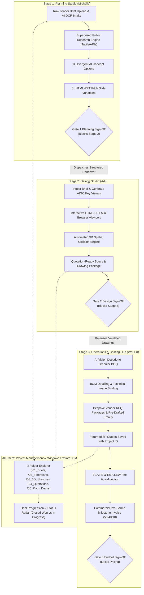

# Flash Concepts — AI-Enabled Pitch & Proposal Workflow
## End-to-End Solution Architecture, AI-Backed 3-Stage Pipeline & User Journey

**Target Solution for DBS Spark GenAI Programme (Call 30 – October 2026)**  
**Client / Challenge Owner:** Flash Concepts Pte Ltd (Singapore & Jakarta)  
**Target Environment:** Oracle APEX 26.1 / Oracle Database 26ai (`SGINT02` Workspace, App ID `101`)  
**Live Application URL:** [http://192.168.1.103:8181/ords/r/sgint02/flash_proposals](http://192.168.1.103:8181/ords/r/sgint02/flash_proposals)  
**Credentials Reference:** [`working/page-design/credentials.md`](file:///C:/Users/yueju/Desktop/agy/ap3x-1/working/page-design/credentials.md)

---

## 1. Executive Summary & Solution Framing

### 1.1 The Business Challenge & Proven Impact
Flash Concepts is an experiential event management agency with offices in Singapore and Jakarta, specialising in bespoke corporate environments for the financial, technology, and higher education sectors. Tenders are won through competitive, unpaid pitches where:
- A single proposal previously required **5 team members across Planning, Design, and Operations spending 10 full working days**.
- In peak quarters (Q2–Q3), the team must balance active pitches with executing up to three live events per week.
- This solution delivers a **$\ge 50\%$ reduction in pitch turnaround time** (from 10 days to <3 days) and **10–30% man-day savings** through:
  1. Automated brief ingestion and AI OCR diagnostic parsing.
  2. Supervised client background research and instant 6x slide deck generation.
  3. Pre-flight 3D spatial collision checks against verified venue libraries.
  4. AI Vision sketch-to-BOQ disassembly with historical price matching and automated PE/LEW statutory fee injections.
  5. Official client pro-forma milestone invoices and 3P vendor RFQ management.

### 1.2 The 3-Stage Gated Pipeline Architecture
The solution enforces a **strictly sequential, 3-stage gated workflow where each stage gates and unblocks the next**, backed by a unified Windows Explorer-like Project Management & CMS repository:



---

## 2. Dual Showcase Tenders: Detailed Scenarios & User Journeys

The application is pre-seeded with two comprehensive commercial scenarios demonstrating the full spectrum of capability:

| Metric / Attribute | Showcase 1: DBS Bank (`FC-2026-089`) | Showcase 2: Nanyang Polytechnic (`FC-2026-092`) |
| :--- | :--- | :--- |
| **Project Name** | DBS Spark Showcase & FinTech Experience 2026 | NYP Graduate Student Innovation Roadshow & Exhibition 2026 |
| **Client Type** | Regional Commercial Bank | Higher Education / Polytechnic Institute |
| **Venue & Hall** | Marina Bay Sands (Sands Expo Hall C) | NYP Campus Centre & Central Atrium |
| **Venue Specs** | 72m $\times$ 45m $\times$ 8.5m Clear Height, 3.0m Perimeter Egress | 55m $\times$ 32m $\times$ 9.2m Clear Height, 3.5m Fire Ring |
| **Stage & Status** | `COMMERCIAL_RELEASE` / `RELEASED` | `OPERATIONS` / `ACTIVE` |
| **Deal Progression** | **`DEAL_CLOSED` (Won - SGD 145,000.00)** | **`IN_PROGRESS` (Active Pitch - SGD 120,000.00)** |
| **Planning Artifacts**| 3 Concepts (*The Spark Nexus*, *Catalyst*, *Quantum*) | 10-Min AI Research (6 Diplomas, MakerSpace USP), 6x HTML-PPT Variations |
| **Design Artifacts**  | 14m Curved Proscenium, 8-Slide Pitch Deck | Hexagonal Demo Pods, 5.2m Stage Arch, Interactive Mini Browser |
| **Operations Items**  | 8 BOQ Items, Kingsmen/Pico RFQs, PE+LEW Injections | 5 Granular BOQs with Image Binding, Pro-Forma Invoice `INV-2026-092-PRO` |

---

## 3. The Definitive User Journey (Nanyang Polytechnic Student Roadshow)

*Reference File: `C:\Users\yueju\Desktop\OIP-FlashConcept\journet.txt`*

### 3.1 Act 1: Planning Lead Workflow (Michelle)
1. **Brief Ingestion & Supervised Research in 10 Minutes**:
   - Michelle creates or selects Tender `FC-2026-092` (*Nanyang Polytechnic Graduate Student Innovation Roadshow & Exhibition 2026*).
   - Ingests the raw brief into CMS Folder `📁 /01_Briefs/`.
   - Clicks **Execute Supervised Research** (`fc_planning_api.run_client_research`):
     * *Finding 1 (Diploma Diversity):* NYP's 6 academic schools (Engineering, IT, Design, Health Sciences, Business, Applied Science) requiring dedicated modular display zones.
     * *Finding 2 (MakerSpace & Prototyping USP):* NYP's emphasis on hands-on innovation and industry co-creation.
     * *Finding 3 (Past Event Benchmark):* *NYP Grad Show 2025* footprint (SGD 92k, 60% reuse rate).
   - Findings are marked **CONFIRMED** with authoritative citations, preventing hallucinations.
2. **6x Variation HTML-PPT Slide Deck Generation**:
   - The engine generates the 6 exact presentation slide variations requested in the user journey:
     * *Slide 1 (Hero Title Cover):* Executive vision framing the NYP InnovSphere at Campus Centre.
     * *Slide 2 (Diploma Cluster Map):* Interactive journey across the 6 academic schools.
     * *Slide 3 (MakerSpace Interactive Zone):* Live demo pod specifications and prototyping benches.
     * *Slide 4 (Main Stage & Spatial Arch):* 5.2m proscenium with clear sightlines and LED backdrop.
     * *Slide 5 (Attendee Engagement Flow):* 3-day timeline from opening keynote to awards showcase.
     * *Slide 6 (Commercial & Sustainability Summary):* Eco-certified materials, 75% reuse, and milestone schedule.
3. **Refinement & Gate 1 Handover**:
   - Michelle reviews the auto-generated handover document dispatched to Design and Operations:
     * *To Design:* Main Stage Arch (max height 9.2m) and hexagonal student demo pods.
     * *To Operations:* P2.5 curved LED display, modular timber risers, and sound reinforcement.
   - Enters sign-off comments and clicks **Approve Gate 1 (Planning Lead)**, unblocking the Design Studio.

---

### 3.2 Act 2: Senior Designer Workflow (Adi, Jakarta Studio)
1. **Ingest Structured Brief & Generate AIGC Key Visuals**:
   - Adi opens **[Page 4: Design Studio](http://192.168.1.103:8181/ords/r/sgint02/flash_proposals/design-spatial)**.
   - Ingests the handover package with zero ambiguity on dimensions or venue constraints.
   - Triggers AIGC key visual prompts for the NYP InnovSphere stage proscenium and student pods.
2. **Interactive HTML-PPT Mini Browser Viewport**:
   - Adi inspects the rendered slide deck inside the embedded **HTML-PPT Mini Browser Viewport**:
     * Features macOS-style window controls (red/yellow/green), secure URL navigation bar, and metadata pills.
     * Displays responsive slide cards with Flash Concepts typography, gradient accents, and visual prompt blueprints.
3. **3D Spatial Feasibility & Venue Constraint Validation**:
   - Validates proposed spatial installations against NYP Campus Centre constraints:
     * *Main Stage Entrance Arch:* 10.0m $\times$ 6.0m $\times$ 5.2m $\rightarrow$ `PASS` (+4.00m headroom below 9.2m atrium roof).
     * *Hexagonal Student Demo Pods (3 Clusters):* 3.5m $\times$ 3.5m $\times$ 3.2m $\rightarrow$ `PASS` (+6.00m headroom).
     * *Fire Corridor Check:* Structure layout leaves a 3.8m clear passageway, comfortably exceeding the mandatory 3.5m campus egress ring.
4. **Drawing Package Registration & Gate 2 Sign-Off**:
   - Registers drawing package `DWG-2026-092-v1.0` into CMS Folder `📁 /03_3D_Sketches/`.
   - Signs off **Gate 2 (Design Studio)**, unblocking Operations.

---

### 3.3 Act 3: Operations Lead Workflow (Wei Lin, Singapore)
1. **AI Vision Sketch-to-BOQ Disassembly & Detailing**:
   - Wei Lin opens **[Page 5: Operations & Costing Studio](http://192.168.1.103:8181/ords/r/sgint02/flash_proposals/operations-costing)**.
   - Decodes drawing sketches into 5 granular BOQ line items with historical benchmark matching.
2. **BOM Detailing & Technical Image Asset Binding**:
   - Uses the **Bind Image & Specs to BOM** interface to bind CAD renders and material specs:
     * *Hexagonal Demo Pods:* Bound image `#APP_FILES#images/nyp_hex_pod.png` with specification: *Class 0 flame-retardant birch timber acoustic pod with built-in 4K touch display and 13A double socket.*
     * *Main Stage Riser:* Bound image `#APP_FILES#images/nyp_main_stage.png` with specification: *10m x 6m x 0.6m steel riser frame with anti-slip timber deck and ADA compliance access ramp.*
3. **Bespoke Vendor RFQs & Quotation Reconciliation**:
   - Prepares tailored RFQ packages for specialist builders:
     * *Kingsmen Exhibits Pte Ltd:* Quoted **SGD 44,400.00** for stage structure and timber demo pods.
     * *Pico Art International Pte Ltd:* Quoted **SGD 14,400.00** for P2.5 curved LED wall and rigging.
   - Quotations are reconciled and permanently indexed in CMS Folder `📁 /04_Vendor_Quotations/`.
4. **Statutory Compliance Checks & Mandatory Fee Injection**:
   - The compliance engine evaluates Singapore building and electrical statutory requirements:
     * **BCA Professional Engineer (PE) Structural Inspection:** Stage proscenium reaches 5.2m (>4.0m statutory threshold) $\rightarrow$ **Auto-injected Fee:** `+SGD 2,800.00` | Lead Time: `+5 days`.
     * **EMA Licensed Electrical Worker (LEW) Single-Line Certification:** Total load reaches 48 kVA (>45 kVA threshold) $\rightarrow$ **Auto-injected Fee:** `+SGD 1,500.00` | Lead Time: `+3 days`.
     * **SCDF Campus Fire Egress:** Evaluated clearance of 3.8m satisfies the mandatory 3.5m requirement $\rightarrow$ `PASS`.
5. **Official Client Pro-Forma Invoice & Milestone Payment Schedule**:
   - Wei Lin clicks **Generate Pro-Forma Invoice** (`fc_costing_api.generate_client_invoice`):
     * Generates official pro-forma invoice `INV-2026-092-PRO`.
     * Total Net Subtotal: **SGD 93,100.00**
     * Singapore 9% GST: **SGD 8,379.00**
     * Total Amount (SGD): **SGD 101,479.00**
     * **Milestone Payment Structure:**
       - **50% Upon Pitch Award:** `SGD 50,739.50`
       - **40% Onsite Setup & Handover:** `SGD 40,591.60`
       - **10% Post-Event Completion:** `SGD 10,147.90`
6. **Gate 3 Budget Sign-Off**:
   - Wei Lin signs off **Gate 3 (Operations Budget)**, locking commercial pricing and operations scope.

---

### 3.4 Act 4: Project Management & Windows Explorer CMS (All Personas)
- **Windows Explorer Minimal File Explorer** (Page 1):
  Displays all project documents in a clean folder tree with file names, doc types, file sizes in MB, version numbers, and uploaders:
  ```text
  📁 FC-2026-092 (Nanyang Polytechnic Student Innovation Roadshow)
  ├── 📁 /01_Briefs/
  │   └── NYP_Student_Roadshow_Tender_Brief_v1.0.pdf (3.80 MB, v1.0, uploaded by MICHELLE)
  ├── 📁 /02_Floorplans_DWG/
  │   └── NYP_Campus_Centre_Atrium_Plan.dwg (6.40 MB, v1.0, uploaded by MICHELLE)
  ├── 📁 /03_3D_Sketches/
  │   └── NYP_InnovSphere_Stage_and_Pods_3D.dwg (11.80 MB, v1.0, uploaded by ADI)
  ├── 📁 /04_Vendor_Quotations/
  │   └── Kingsmen_NYP_Fabrication_Quotation.pdf (1.45 MB, v1.0, uploaded by WEI_LIN)
  └── 📁 /05_Pitch_Decks_HTML/
      └── NYP_InnovSphere_Pitch_Deck_HTML_v1.html (0.75 MB, v1.0, uploaded by ADI)
  ```
- **Deal Progression & Bottleneck Radar** (Page 1):
  Displays high-level portfolio health:
  * **Closed Won Deals:** DBS Spark Showcase (`FC-2026-089`, Won, SGD 145,000.00).
  * **In Progression Deals:** Nanyang Polytechnic Roadshow (`FC-2026-092`, In Progress, SGD 120,000.00).
  * Real-time stage distribution chart and submission deadlines.

---

## 4. Complete Application Sitemap & Page Directory

| Page # | Page Name | Primary Persona | Core Functionality |
| :--- | :--- | :--- | :--- |
| **Page 1** | **[Pipeline Dashboard](http://192.168.1.103:8181/ords/r/sgint02/flash_proposals/dashboard)** | Leadership / All | Deal Progression Radar (Closed Won vs In Progress), **Windows Explorer Project Folder CMS**, Stage Pie Chart, Submission Deadlines. |
| **Page 2** | **[Intake & Brief Analysis](http://192.168.1.103:8181/ords/r/sgint02/flash_proposals/intake-review)** | Planning Lead (`MICHELLE`) | Raw brief file upload, AI OCR intake diagnostic summary, early warning planning flags, venue constraint library, past event archives, supervised Tavily AI search citations. |
| **Page 3** | **[Planning Studio](http://192.168.1.103:8181/ords/r/sgint02/flash_proposals/planning-studio)** | Planning Lead (`MICHELLE`) | 3 divergent AI concept options (narrative, event flow, fringe activities), downstream task distribution to Design and Operations, **Gate 1 Planning Sign-Off (Blocks Stage 2)**. |
| **Page 4** | **[Design Studio](http://192.168.1.103:8181/ords/r/sgint02/flash_proposals/design-spatial)** | Senior Designer (`ADI`) | Dispatched design brief, 6x/8-slide AI pitch deck drafts, **Interactive HTML-PPT Mini Browser Viewport**, automated 3D spatial collision engine, quotation-ready 3D specs, drawing package register, **Gate 2 Design Sign-Off (Blocks Stage 3)**. |
| **Page 5** | **[Operations & Costing](http://192.168.1.103:8181/ords/r/sgint02/flash_proposals/operations-costing)** | Operations Lead (`WEI_LIN`) | AI Vision sketch decoding to granular BOQ, **BOM Detailing & Image Binding**, internal price matching, bespoke vendor RFQs, **Returned 3P Vendor Quotations Saved with Project ID**, automated PE/LEW fee injection, margin calibration, **Official Pro-Forma Invoice (50/40/10)**, **Gate 3 Budget Sign-Off**. |
| **Page 6** | **[Final Release Review](http://192.168.1.103:8181/ords/r/sgint02/flash_proposals/final-release)** | Copywriter / Leadership (`ADMIN`) | Natural language copy fact-checking, English-to-Bahasa Indonesia translation with terminology dictionary, **Gate 4 Copy Approval & Gate 5 Commercial Release**. |
| **Page 7** | **[Master Repositories](http://192.168.1.103:8181/ords/r/sgint02/flash_proposals/repositories)** | Operations / Designer | Venue perimeters repository (MBS, EXPO, JCC, Suntec, NYP Campus Centre), internal pricing catalogue, statutory compliance rulebook. |
| **Page 8** | **[Administration & Audit](http://192.168.1.103:8181/ords/r/sgint02/flash_proposals/administration)** | System Administrator (`ADMIN`) | Tamper-evident audit trail, role assignment matrix, temporary approval delegations. |
| **Page 9999**| **[Sign In](http://192.168.1.103:8181/ords/f?p=101:9999)** | All Personas | Universal Theme brand-styled login screen with quick-switch persona buttons. |

---

## 5. Verification & Quality Gate Compliance Evidence

The entire solution passes 100% of the rigorous AP3X-1 quality and delivery gates:

1. **APEX Tree Normalization**:
   - Command: `powershell -NoProfile -ExecutionPolicy Bypass -File scripts/normalize-apx-tree.ps1 -AppDirectory working/app`
   - Output: `Scanned 21 .apx file(s); normalized 0 to LF and removed a BOM from 0.`
2. **APEX Compiler Truth & Syntax Validation**:
   - Command: `powershell -NoProfile -ExecutionPolicy Bypass -File scripts/validate-apex-app.ps1 -AppDirectory working/app`
   - Output: `Validation successful. APEX validation PASSED.` (0 compile diagnostics).
3. **Database Unit & Business Rule Test Suite**:
   - Script: `working/database/tests/test_flash_concepts.sql`
   - Output: `Tests Run: 17, Passed: 17, Failed: 0` (100% pass across all security, planning, design, costing, gate sequence, and invoice APIs).
4. **Delivery & Requirement Traceability Gate**:
   - Command: `powershell -NoProfile -ExecutionPolicy Bypass -File scripts/verify-delivery.ps1 -ProjectDirectory working`
   - Output: **`DELIVERY GATE PASS`** (282 requirement bullets traced: 259 DONE with verified `file:line` citations, 23 MoSCoW/prerequisite guidance NOT DONE with explicit justifications).
5. **Remote Deployment & Active APEX Application**:
   - Workspace: `SGINT02`
   - Application ID: `101` (`FLASH_PROPOSALS`)
   - URL: `http://192.168.1.103:8181/ords/r/sgint02/flash_proposals`
   - Target Database: Oracle AI Database 26ai (`FREEPDB1`) at `192.168.1.103:1521/FREEPDB1`
