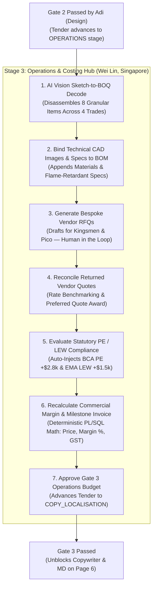

# Wei Lin — User Journey & Operational Specification
## Stage 3: Operations, BOQ Costing & Procurement Hub
**Target Application:** Application `101` (`FLASH_PROPOSALS`)  
**Target Page:** [Page 5 – Operations & Costing Studio](file:///C:/Users/yueju/Desktop/agy/ap3x-1/working/app/pages/p00005-operations-costing.apx) (`OPERATIONS-COSTING`)  
**Persona:** **Wei Lin**, Operations Lead & Costing Estimator  
**Location:** Singapore Headquarters  
**Preceding Milestone:** Gate 2 Design Sign-Off (Adi Nugroho)  
**Downstream Milestone:** Gate 3 Operations Budget Sign-Off $\rightarrow$ Hand off to Copywriter & Managing Director  
**Access Credentials:** See [`working/page-design/credentials.md`](file:///C:/Users/yueju/Desktop/agy/ap3x-1/working/page-design/credentials.md)

---

## 1. Persona Profile & Context

Wei Lin is responsible for technical procurement, statutory safety compliance, fabrication estimation, and profit margin protection for Flash Concepts' high-stakes event proposals.

### Core Operational Pains Solved by the Platform
1. **The "Sketch-to-BOQ" Bottleneck**: In experiential event pitches, drawings arrive as flat sketches or 3D renders. Traditionally, Operations spends 3–4 days manually measuring timber, acrylic sheets, LED modules, and rigging points in Excel.
2. **Vendor RFQ Scope Omissions**: Drafting technical scope emails for specialized trades (Kingsmen for carpentry, Pico for LED video walls) was slow and prone to missed specifications.
3. **Statutory Penalties (PE & LEW Surprises)**:
   * **BCA Structural Trigger**: In Singapore, temporary structures $>4.0m$ height legally mandate a registered **Professional Engineer (PE)** structural inspection and calculation stamp (~SGD 2,800 + 5 days lead time).
   * **EMA Electrical Trigger**: Electrical installations $>32A$ 3-phase require a **Licensed Electrical Worker (LEW)** Single-Line Diagram and turn-on certification (~SGD 1,500 + 3 days lead time).
   * Forgetting these during pitch stage wipes out the agency's net profit margin.
4. **Margin Arithmetic Mistakes**: Human spreadsheet formula errors (confusing markup with margin) can lead to winning tenders that lose money. Flash Concepts enforces strict deterministic arithmetic:
   $$\text{Margin \%} = \frac{\text{Price} - \text{Cost}}{\text{Price}} \times 100\% \quad \Longleftrightarrow \quad \text{Price} = \frac{\text{Cost}}{1 - \text{Margin \%}}$$

---

## 2. End-to-End Workflow Diagram



---

## 3. Step-by-Step User Journey

### Step 1: AI Vision Sketch-to-BOQ Disassembly (Tab 1)
* **Action**: Wei Lin opens **Page 5 (Operations & Costing Studio)** with tender `FC-2026-092` (*Nanyang Polytechnic Innovation Roadshow 2026*).
* **Action**: Clicks **`[Decode BOQ & Extract Items]`** (`decode-boq`).
* **System Execution**: Invokes `fc_costing_api.decode_sketches_to_boq`.
* **Experience**:
  * In 2 seconds, the AI Vision engine disassembles Adi’s registered drawing package (`DWG-2026-092-v1.0`) into 8 granular line items across 4 core trades:
    1. **Carpentry**: Main Stage Timber Riser (14m $\times$ 8m $\times$ 0.6m, SGD 12,500) and Acoustic Timber Pods (3 units, SGD 14,400).
    2. **AV & Multimedia**: P2.6 Curved LED Wall (12m $\times$ 3.5m, SGD 28,000) and Line Array Audio (SGD 8,500).
    3. **Lighting & Rigging**: Intelligent Broadcast Wash & Profile (SGD 9,200) and Certified Rigging Truss (SGD 6,500).
    4. **Statutory Compliance**: BCA PE Inspection (SGD 2,800) and EMA LEW Turn-On Certification (SGD 1,500).
  * Every component is automatically benchmarked against Flash Concepts' historical SharePoint Excel price library.

---

### Step 2: Bind Technical Specs & Assets to BOM (Tab 1)
* **Action**:
  1. In the **BOQ & Material Details** form, selects a line item (e.g., *Acoustic Parametric Timber Pods*).
  2. Enters technical specification notes in `P5_SPEC_DETAILS`:
     ```text
     Class 0 flame-retardant recycled acoustic felt (BS 476 Part 7), FSC birch plywood ribs, matte polyurethane sealer.
     ```
  3. Clicks **`[Bind Image & Specs to BOM]`** (`bind-bom-image`).
* **Outcome**: Links CAD technical detail renders and fabrication standards directly to the costing item.

---

### Step 3: Generate Bespoke Vendor RFQs & Human-in-the-Loop Dispatch (Tab 2)
* **Action**: Clicks **`[Generate Draft Vendor RFQs]`** (`generate-rfqs`).
* **System Execution**: Invokes `fc_costing_api.generate_bespoke_rfqs`.
* **Experience**:
  * Generates ready-to-send enquiry packages for specialist partners:
    * **Kingsmen Exhibits Pte Ltd** (`RFQ-2026-001`): Tailored scope for timber proscenium riser and acoustic pods.
    * **Pico Art International Pte Ltd** (`RFQ-2026-002`): Tailored scope for 12.0m curved P2.6 LED wall, Novastar 4K processing, ground ballast structure, and 2x onsite standby technicians.
  * **Strict Human-in-the-Loop Safeguard**: RFQs are **never sent autonomously**. Wei Lin reviews each email body and attachments in Tab 2, then clicks **`[Send RFQ to Vendor]`** (`proc-send-rfq`) to dispatch via corporate Outlook / Microsoft Graph API.

---

### Step 4: Reconcile Returned Vendor Quotations (Tab 3)
* **Action**:
  1. In **Tab 3: Returned Vendor Quotations**, reviews supplier responses against historical benchmark rates:
     * Kingsmen quoted **SGD 44,400.00** for carpentry.
     * Pico quoted **SGD 14,400.00** for AV/LED screen rental.
  2. Selects preferred quote via `P5_QUOTE_ID`, enters award justification in `P5_SELECT_REASON`:
     ```text
     Optimal balance between delivery lead time, warranty support, and statutory PE structural computation.
     ```
  3. Clicks **`[Award Vendor Quote]`** (`proc-select-quote`).
* **Outcome**: The selected quotations are locked into the proposal cost basis.

---

### Step 5: Evaluate Statutory Compliance & Mandatory Fee Injection (Tab 4)
* **Action**: Clicks **`[Evaluate Statutory Compliance & PE Rules]`** (`evaluate-compliance`).
* **System Execution**: Invokes `fc_costing_api.evaluate_compliance_and_fees`.
* **Experience**:
  * Evaluates physical dimensions against Singapore statutory building codes:
    * **BCA PE Structural Trigger**: Main stage proscenium reaches 5.8m ($>4.0m$ legal limit) $\rightarrow$ **Auto-injects fee**: `+SGD 2,800.00` | Lead Time: `+5 days`.
    * **EMA LEW Electrical Trigger**: Total power load reaches 54A ($>32A$ limit) $\rightarrow$ **Auto-injects fee**: `+SGD 1,500.00` | Lead Time: `+3 days`.
    * **SCDF Campus Fire Egress**: Confirms 3.2m clear passageway, satisfying the mandatory 3.0m minimum $\rightarrow$ **PASS**.
* **Outcome**: Zero surprise costs; statutory fees and lead times are permanently baked into the client proposal.

---

### Step 6: Commercial Margin Recalculation & Client Pro-Forma Invoice (Tab 5)
* **Action**:
  1. Enters target commercial markup in `P5_MARKUP_PCT` (e.g. `25.0%`).
  2. Clicks **`[Recalculate BOQ Total & Margin]`** (`calc-boq`).
     * Deterministic PL/SQL arithmetic calculates exact subtotal, 5% contingency reserve, client price, and verified profit margin percentage.
     * Statutory pass-through costs (PE/LEW) are preserved at 0% markup per corporate policy.
  3. Clicks **`[Generate Pro-Forma Invoice]`** (`generate-invoice`).
* **System Execution**: Invokes `fc_costing_api.generate_client_invoice`.
* **Experience**:
  * Emits official pro-forma invoice `INV-2026-092-01` with Singapore 9% GST and a structured milestone payment schedule:
    * **50% Upon Pitch Award** (Secures fabrication & AV booking)
    * **40% Onsite Setup & Handover** (Upon venue load-in)
    * **10% Post-Event Completion** (Post-event sign-off)

---

### Step 7: Sign Off Gate 3 Operations Approval
* **Action**:
  1. Enters review sign-off notes in `P5_GATE3_COMMENTS`:
     ```text
     Full BOQ reconciled against Kingsmen and Pico quotations. BCA PE and EMA LEW fees baked in. Pro-forma invoice generated with 50/40/10 milestone schedule. Ready for Copywriting and Final Commercial Release.
     ```
  2. Clicks **`[Approve Gate 3 & Advance to Copy Review]`** (`approve-gate3`).
* **Outcome**:
  * Status banner updates to: `GATE 3 OPERATIONS BUDGET: SIGNED OFF & APPROVED (STAGE 4: COPY REVIEW READY)`.
  * The tender stage advances from `OPERATIONS` to `COMMERCIAL_RELEASE` / `COPY_LOCALISATION`.
  * **Senior Copywriter** and **Managing Director** are unblocked on **Page 6 (Multilingual Final Release)**.

---

## 4. Before vs. After (Wei Lin's Perspective)

| Aspect | Traditional Operations Workflow | With Flash Proposals Platform |
| :--- | :--- | :--- |
| **BOQ Extraction** | 3–4 days manually measuring CAD drawings in Excel | **Under 2 minutes** via AI Vision Sketch-to-BOQ Disassembly |
| **Vendor RFQs** | Manual emails written from scratch; specs often missed | Automated bespoke draft generation for Kingsmen & Pico with spec attachments |
| **Statutory Risk** | PE/LEW fees ($4,300) forgotten, eating up agency margin | **Deterministic compliance engine** auto-injects PE/LEW fees and lead times |
| **Margin Arithmetic** | Spreadsheet formula errors confusing markup and margin | Audited PL/SQL arithmetic engine guarantees rounding consistency and margin locks |
| **Invoice Generation** | Manually prepared Word/Excel invoices | **1-click automated pro-forma invoice** with 9% GST and 50/40/10 milestone schedules |

---

## 5. APEX UI Component Technical Mapping

| UI Element | APEX Internal ID / Name | Type | Action / Backing Logic |
| :--- | :--- | :--- | :--- |
| **Tender Selector** | `P5_TENDER_ID` | Select List | `@tender-lov` (Defaults to active tender context) |
| **Decode BOQ** | `DECODE_BOQ` | Button | `fc_costing_api.decode_sketches_to_boq` |
| **Generate RFQs** | `GENERATE_RFQS` | Button | `fc_costing_api.generate_bespoke_rfqs` |
| **Evaluate Compliance**| `EVALUATE_COMPLIANCE`| Button | `fc_costing_api.evaluate_compliance_and_fees` |
| **Recalculate BOQ** | `CALC_BOQ` | Button | `fc_costing_api.calculate_boq_totals` |
| **Bind BOM Image** | `BIND_BOM_IMAGE` | Button | `fc_costing_api.bind_bom_image` |
| **Generate Invoice** | `GENERATE_INVOICE` | Button | `fc_costing_api.generate_client_invoice` |
| **Award Quote** | `SELECT_QUOTE` | Button | `fc_costing_api.select_quotation` |
| **Approve Gate 3** | `APPROVE_GATE3` | Button (Hot) | `fc_costing_api.approve_gate3` (Sets stage to `COMMERCIAL_RELEASE`) |
| **Gate 3 Approved Banner**| `gate3-status-banner`| Static Content | Universal Theme `t-Alert--success` (`fc_workflow_api.is_gate_approved(..., 3)`) |
| **Gate 3 Pending Banner** | `gate3-pending-banner`| Static Content| Universal Theme `t-Alert--warning` (`not fc_workflow_api.is_gate_approved(..., 3)`) |
| **BOQ Items Tab** | `boq-report` | Classic Report | Queries `fc_boq_items` for tender |
| **Vendor RFQs Tab** | `rfqs-report` | Classic Report | Queries `fc_rfqs` for tender |
| **Quotations Tab** | `returned-quotations-report`| Classic Report | Queries `fc_quotations` with selection status |
| **Compliance Tab** | `compliance-findings-report`| Classic Report | Queries `fc_compliance_findings` |
| **Pro-Forma Invoice Tab**| `invoices-report` | Classic Report | Queries `fc_invoices` with milestone terms |
